# Multistore AI Assistant

**English** · [Português](README.pt.md)


[](https://github.com/PedroPinho17/multistore-ai-assistant/actions/workflows/tests.yml)

<p align="center">
  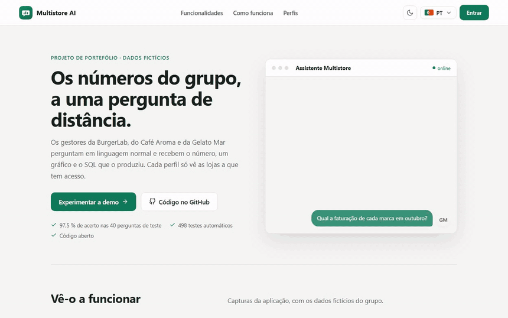
</p>
<p align="center"><sub>Demo at 2× speed · <a href="docs/media/demo.mp4">full-quality video</a> · three profiles, same questions, different answers (row-level security) · fictional data</sub></p>

Managers of a (fictional) Portuguese restaurant group ask questions in **Portuguese, English, Spanish or French**. The assistant writes the **SQL**, runs it on PostgreSQL under **row-level security**, and answers in plain language with a chart and the query it used. It also **forecasts sales** and suggests ingredient orders.

> All data is fictional (Faker `pt_PT`, fixed seed): 3 brands (BurgerLab, Café Aroma, Gelato Mar), 15 stores, warehouses, staff, menus, recipes, stock, purchases and sales from Jan 2025 until yesterday. The idea comes from my BSc final project ([Projeto Final](https://github.com/PedroPinho17/PF_2024_2025)); this is a new version written from scratch.

## Highlights

- **Text-to-SQL that is safe by design.** The LLM's SQL is treated as hostile: it is parsed and validated (`sqlglot`), then runs as a read-only role, in a read-only transaction, under **PostgreSQL row-level security** with an HMAC-signed context. Each role sees only its group, brand or store, whatever the prompt says.
- **Three roles, one assistant.** Group manager, brand manager and store manager ask the same question and get different answers. Personal data (tax and social security numbers, addresses) is revoked at column level.
- **Local intent classifier** (fine-tuned XLM-RoBERTa) routes greetings, refusals, forecasts and orders without an LLM call.
- **RAG with pgvector**, a **SQL cache** for repeated questions in any of the four languages, and a **👎 review loop** where a reviewer fixes the SQL, tests it and teaches the assistant.
- **Sales forecasting** with real weather (Open-Meteo) and Portuguese holidays, plus ingredient order suggestions.
- **Product-ready web app** (Vue 3 + Vite): streaming answers, charts, follow-up suggestions, saved conversations, accounts and modules, observability dashboard, password reset by email, dark mode, four languages, accessible, mobile.
- **Tested and reproducible:** 941 tests (including attacks on the database and RLS performance), one-command Docker setup, versioned migrations, CI.

| Answer with chart and table | Store manager: RLS + the SQL used |
|---|---|
| 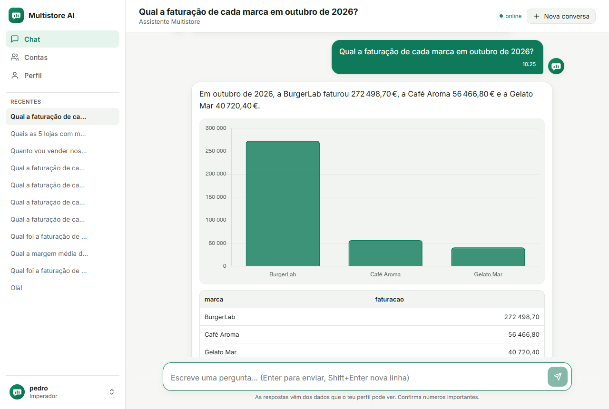 | 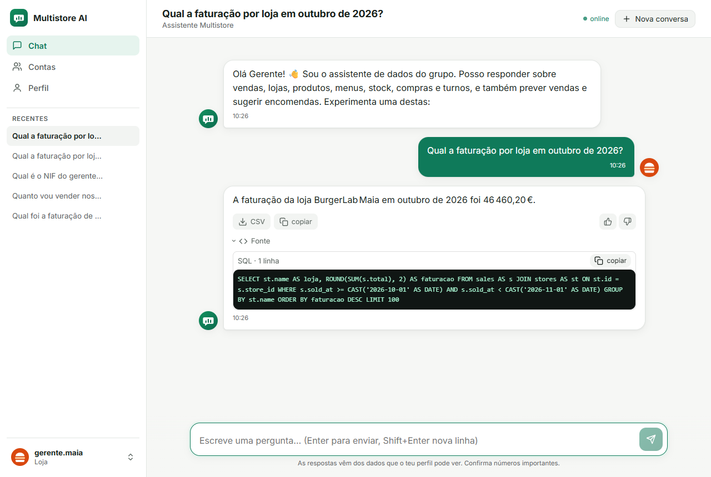 |
| **Sales forecast (ML), dark mode** | **Observability dashboard (admin)** |
| 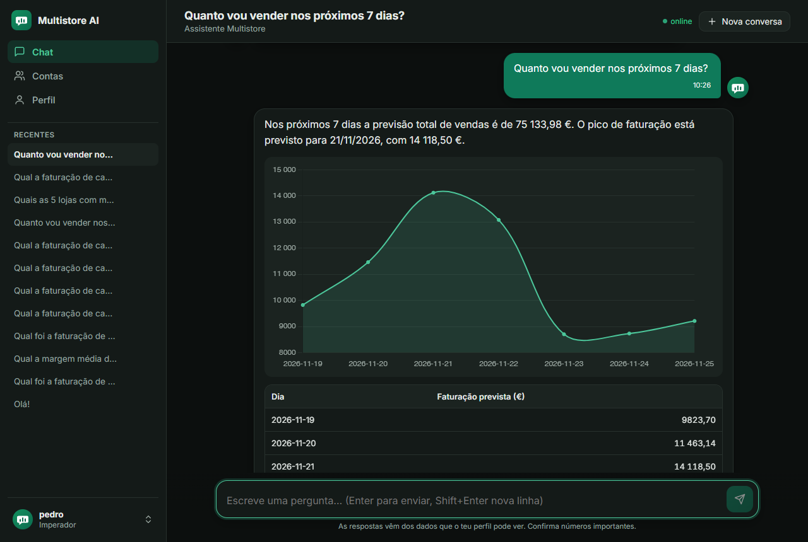 | 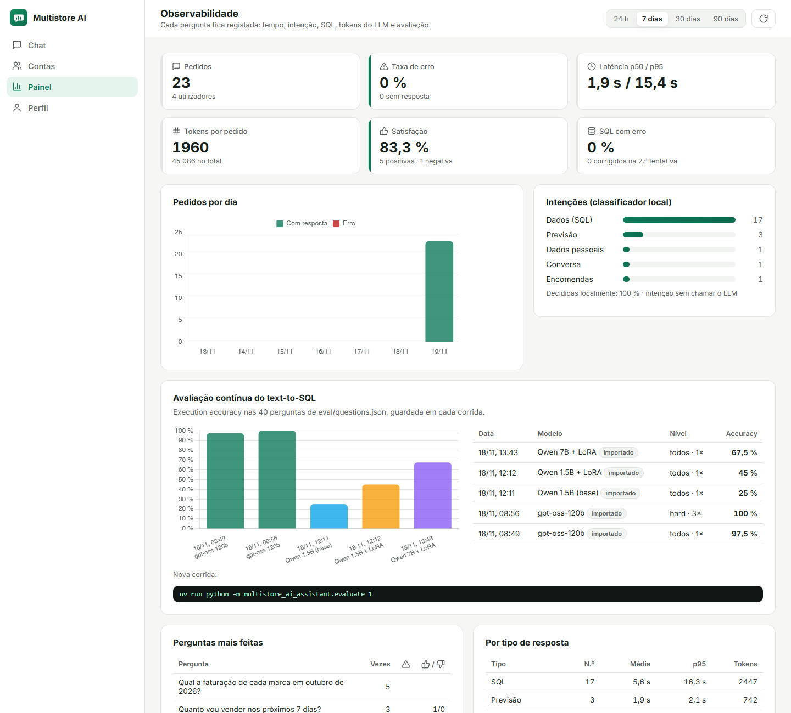 |

<details>
<summary>More screenshots: home, sign-in, profile, accounts, settings, mobile</summary>

| Home page | Sign-in with demo accounts |
|---|---|
| 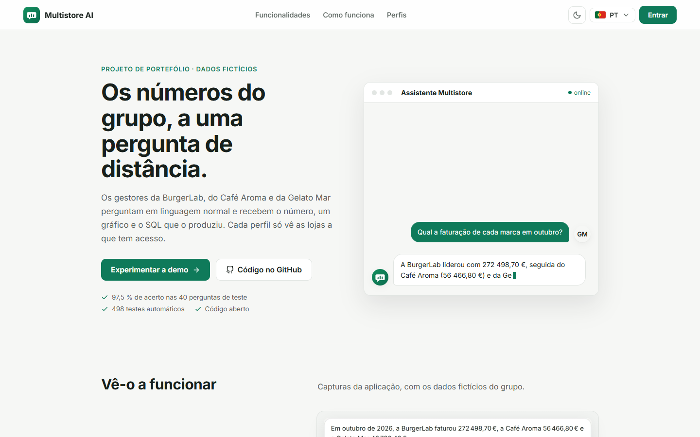 | 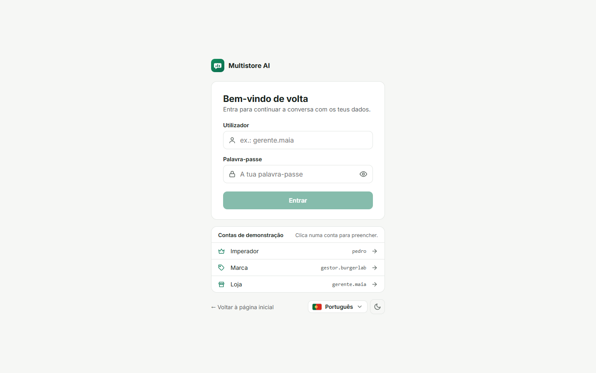 |
| **Profile** | **Accounts: roles, scope and modules** |
| 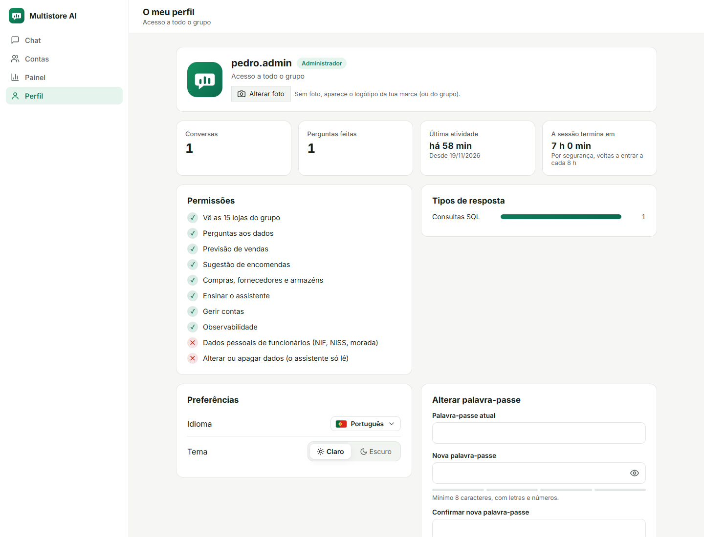 | 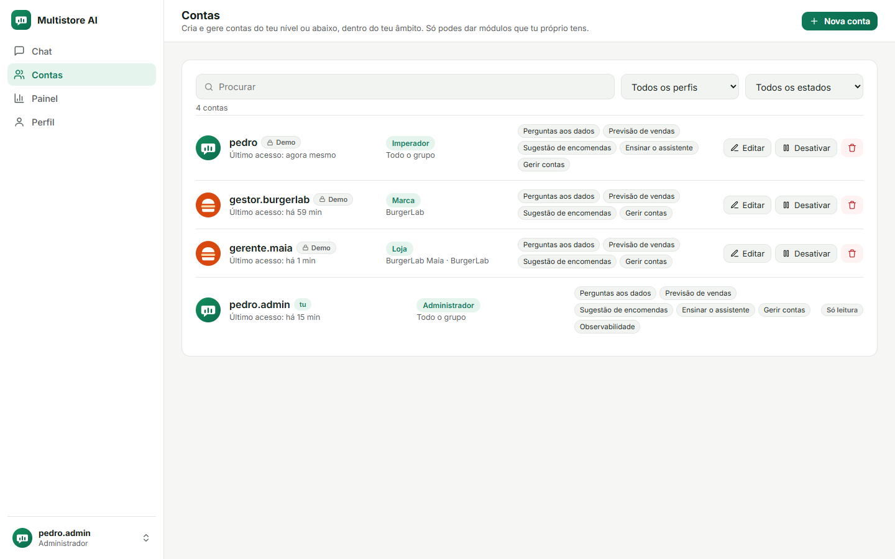 |
| **Settings** | **Mobile** |
| 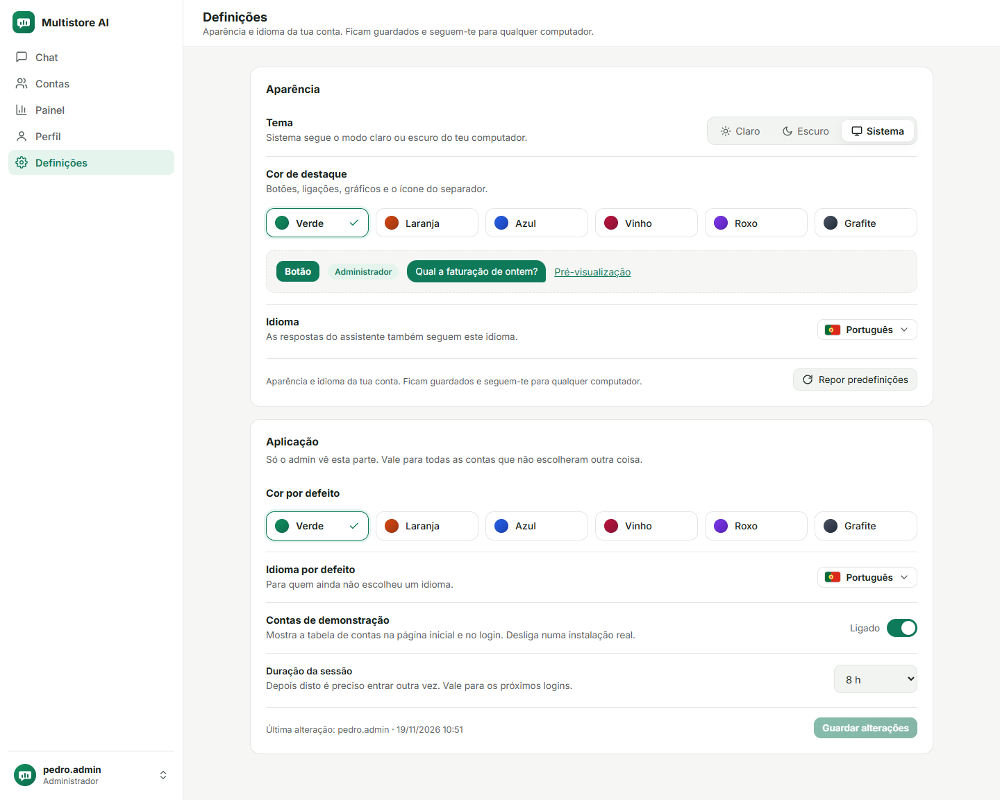 | 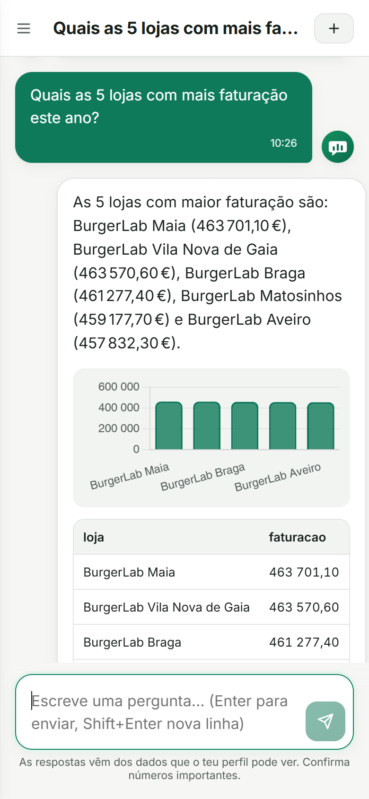 |
| **Follow-up question (*"E em setembro?"*)** | |
| 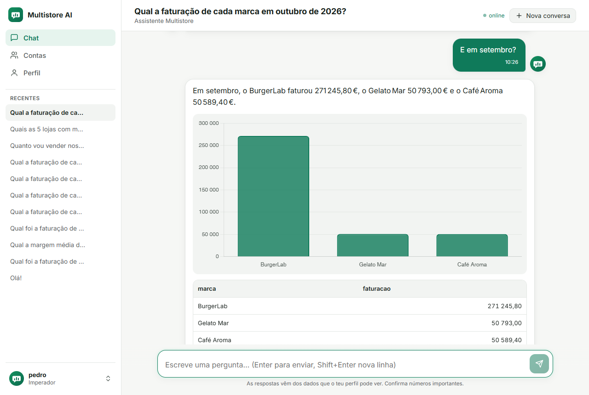 | |

</details>

## Architecture

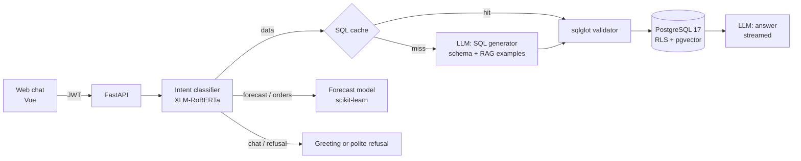

Design decisions (why Groq and not a local model, why XLM-R, why RLS with a signed context), the life of a question and the known limits: **[docs/ARCHITECTURE.md](docs/ARCHITECTURE.md)**.

## Security

| Layer | What it does |
|---|---|
| **Signed RLS context** | Every query carries the role, brand and store **plus an HMAC signature**. Policies only trust the role if the signature matches a key the query role cannot read, so `set_config('app.role', 'imperador', …)` returns **zero rows**. |
| **Read-only role** | `SELECT` only, read-only transactions, 10 s timeout, no access to private tables, column-level `REVOKE` on personal data. |
| **SQL validator** | One query only; no DML/DDL, system catalogs or functions that change the session, read files or open connections. Timestamp comparisons are rewritten so plans stay fast under RLS. |
| **API** | Rate limits, ownership checks, constant-time login, JWT with required claims, generic errors, `/docs` off by default. Password reset uses single-use, 30-minute tokens stored as SHA-256 and never reveals which emails exist. |
| **Features by role** | Chat, forecast, orders, dashboard, profitability/review, accounts and admin are granted per role (`role_features`). Only the admin role edits them, on the admin page, and only it can hold the admin feature. A missing feature hides the page and returns 403. The chat opens with chat, forecast or orders, and each question is checked again: a data, forecast or orders question the role can't ask is refused in PT/EN/ES/FR and returns no rows. |
| **Browser** | Strict CSP (`script-src 'self'`), `X-Frame-Options: DENY`, `nosniff`, no referrer, session token in `sessionStorage`, CSV formula-injection guard. |
| **Infra** | No secrets in code; the database port is bound to `127.0.0.1`. |

Known limits (fine for a demo): in-memory rate limiter (use Redis with several workers). Password changes and resets revoke older JWTs: each token carries the account's `token_version`, which every change bumps (the user who changed their password gets a fresh token).

## Results

**Text-to-SQL.** 40 hand-written questions (`eval/questions.json`) in PT and EN, each with a reference SQL; a question is correct when the generated SQL returns the same result (execution accuracy).

| Model | Easy | Medium | Hard | Refusal | Total |
|---|---|---|---|---|---|
| **Groq gpt-oss-120b** (production) | 10/10 | 15/15 | 10/10 | 5/5 | **40/40 = 100 %** |
| Qwen2.5-Coder-7B + LoRA | 9/10 | 9/15 | 4/10 | 5/5 | 27/40 = 67.5 % |
| Qwen2.5-Coder-1.5B + LoRA | 5/10 | 7/15 | 1/10 | 5/5 | 18/40 = 45 % |
| Qwen2.5-Coder-1.5B base | 5/10 | 3/15 | 1/10 | 1/5 | 10/40 = 25 % |

For Groq, the hard questions were also run 3 times each: 30/30. The small models were fine-tuned with LoRA (Unsloth) on a free Kaggle T4 using 510 verified question/SQL pairs: fine-tuning almost doubled the 1.5B model and fixed its refusals (1/5 → 5/5), but window functions and multi-period comparisons still need the large hosted model. Notebooks: [Qwen 1.5B](https://kaggle.com/kernels/welcome?src=https://github.com/PedroPinho17/multistore-ai-assistant/blob/main/notebooks/finetune_qwen1.5b_kaggle.ipynb) · [Qwen 7B](https://kaggle.com/kernels/welcome?src=https://github.com/PedroPinho17/multistore-ai-assistant/blob/main/notebooks/finetune_qwen7b_kaggle.ipynb).

**Intent classifier.** 733 sentences in PT and EN; 5-fold cross-validation split by template, so the same template is never in train and test.

| | MiniLM + LogisticRegression | **XLM-RoBERTa fine-tuned** (production) |
|---|---|---|
| Accuracy | 94.8 % | **97.8 %** |
| Macro F1 | 0.935 | **0.965** |
| Decided without the LLM (threshold) | 93.0 % (0.60) | **98.1 %** (0.90) |
| Accuracy on those | 97.5 % | **98.7 %** |

XLM-R also classifies Spanish and French correctly although trained only on PT and EN. Reports: [`eval/intent_report_xlmr.txt`](eval/intent_report_xlmr.txt), [`eval/intent_report.txt`](eval/intent_report.txt); notebook: [XLM-RoBERTa](https://kaggle.com/kernels/welcome?src=https://github.com/PedroPinho17/multistore-ai-assistant/blob/main/notebooks/intent_xlmr_kaggle.ipynb).

**Sales forecast.** HistGradientBoosting on daily revenue, last 60 days held out:

| Model | MAE |
|---|---|
| Baseline (same day last week) | 145.94 € |
| Calendar + lags | 109.90 € |
| **+ real weather and holidays** | **102.28 €** |

The weather is real (Open-Meteo, 6 districts) and drives the generated sales: ice cream sells ×1.81 on hot days and ×0.38 on rainy ones; cafés sell more when it is cold.

## Quick start

You need Docker and a free [Groq API key](https://console.groq.com/keys).

```bash
cp .env.example .env      # fill in POSTGRES_PASSWORD, both DB URLs, GROQ_API_KEY and JWT_SECRET
docker compose up --build
```

Open http://localhost:8001. The first start creates the database (schema, migrations and the fictional data), trains the missing models and takes a few minutes; later starts take seconds. The database is not in the repository: it is generated with a fixed seed, so everyone gets the same data.

### Demo accounts

| User | Password | Role | Sees |
|---|---|---|---|
| `pedro` | `imperador123` | group manager | whole group |
| `gestor.burgerlab` | `marca123` | brand manager | BurgerLab only |
| `gerente.maia` | `loja123` | store manager | one store |

Ask the same question with each account to see row-level security at work. Their passwords are public, so demo accounts are read-only where it matters (no account changes, password, photo or email). Your private admin account comes from `ADMIN_USERNAME` / `ADMIN_PASSWORD` in `.env`.

### Configuration (`.env`)

| Variable | Purpose |
|---|---|
| `POSTGRES_PASSWORD`, `DATABASE_URL`, `READONLY_DATABASE_URL` | Database superuser, owner connection and the read-only role that runs generated SQL |
| `GROQ_API_KEY`, `LLM_BASE_URL`, `LLM_MODEL` | LLM (any OpenAI-compatible endpoint) |
| `GROQ_API_KEY_FALLBACK` | Optional. Key from a second account, used automatically when the main key runs out of quota (HTTP 429) |
| `JWT_SECRET` | At least 32 random characters |
| `APP_URL`, `SMTP_HOST`, `SMTP_PORT`, `SMTP_SECURITY`, `SMTP_USER`, `SMTP_PASSWORD`, `SMTP_FROM` | Optional. Password reset emails; without `SMTP_HOST` nothing is sent |
| `ADMIN_USERNAME`, `ADMIN_PASSWORD`, `ADMIN_EMAIL` | Optional. Private admin account created on start |
| `APP_PORT`, `ENABLE_DOCS`, `INTENT_MODEL`, `DB_POOL_MAX`, `HF_HUB_OFFLINE` | Optional. Port, Swagger at `/docs`, classifier (`xlmr` / `minilm`), pool size, offline embeddings |
| `AVATAR_DIR` | Optional. Folder for profile photos (default `data/avatars`, a Docker volume; not in git) |

<details>
<summary>Manual setup (for development)</summary>

You need Docker, [uv](https://docs.astral.sh/uv/) and a Groq API key.

```powershell
cp .env.example .env
uv sync
docker compose up -d db
Get-Content db\schema.sql | docker compose exec -T db psql -U multistore -d multistore   # Linux/macOS: psql ... < db/schema.sql
uv run python -m multistore_ai_assistant.data.generate
uv run python -m multistore_ai_assistant.data.generate_activity    # history + days until yesterday
uv run python -m multistore_ai_assistant.db.migrate                # roles, RLS, views, indexes, RAG, cache…
uv run python -m multistore_ai_assistant.data.set_passwords        # demo users + read-only role password
uv run python -m multistore_ai_assistant.data.seed_examples
uv run python -m multistore_ai_assistant.forecast.train
uv run python -m multistore_ai_assistant.intent.train              # MiniLM; XLM-R: unzip the Kaggle output into models/intent-xlmr
cd frontend; npm ci; npm run build; cd ..                         # the UI (frontend/dist), served by the API at /
uv run uvicorn multistore_ai_assistant.api.main:app --port 8001
```

Without `frontend/dist` the API still runs, but `/` answers 503 "frontend not built, run npm run build in frontend".

Other commands: `db.migrate --status`, `assistant.ask "question"` (CLI), `evaluate 1` (evaluation, saved to `eval/results`).
</details>

### Tests

```bash
uv run pytest                  # everything (~2 min); database and model tests skip themselves if not available
uv run pytest tests/unit       # no database, no LLM, no models (~6 s)
uv run pytest --cov            # with coverage
```

**941 tests** (unit + integration), **96 % coverage** of the code that runs in the app. They cover the SQL validator against attack patterns, JWT forging, every API endpoint, RLS per role on the real database (`set_config` attacks and forged signatures return zero rows), query timings under RLS, migrations, the SQL cache, the LLM key fallback, the password reset flow and profile photo uploads (fake images, size, type).

<details>
<summary>API</summary>

| Method | Path | Auth | Description |
|---|---|---|---|
| `POST` | `/login` | – | `{username, password}` → `{token, user}` |
| `POST` | `/password/forgot` | – | `{login, lang}` → always `{ok: true}`; emails a reset link if the account exists |
| `POST` | `/password/reset` | – | `{token, new_password}` |
| `GET` | `/me`, `/profile` | Bearer | Current user, modules, scope and usage stats |
| `POST` / `PUT` | `/profile/password`, `/profile/email` | Bearer | Change own password / recovery email (not for demo accounts) |
| `POST` / `DELETE` | `/me/avatar` | Bearer | Own profile photo: raw PNG/JPEG/WebP body up to 2 MB, checked with Pillow and stored as a 256×256 WebP without EXIF; `DELETE` goes back to initials (not for demo accounts) |
| `GET` | `/avatars/{uuid}.webp` | Bearer | A profile photo (URLs come from `/me` and `/users`, with `?v=` for cache-busting) |
| `POST` | `/ask`, `/ask/stream` | Bearer | `{question, lang, conversation_id?}` → answer, SQL, rows, suggestions (stream: Server-Sent Events; stops the LLM if the client disconnects) |
| `POST` | `/explain` | Bearer (*sql*) | Plain-language explanation of the SQL of one of your answers |
| `GET` | `/alerts` | Bearer | Sales drops/rises and low stock in your scope |
| `GET` | `/dashboard` | Bearer (*sql* and/or *forecast*) | Sales KPIs in your RLS scope: month-to-date revenue vs the same days last month, top stores, margin by brand (products without a known cost are left out and counted), 7-day forecast (cached per day). Only the sections your modules allow |
| `POST` | `/ratings` | Bearer | 👍 / 👎 on your own answers |
| `GET` / `POST` / `PUT` / `DELETE` | `/examples…`, `/review…`, `/feedback` | Bearer (*teach*) | RAG examples and the 👎 review loop (validator + `EXPLAIN` before saving) |
| `GET` / `POST` / `PATCH` / `DELETE` | `/users…` | Bearer (*users*) | Accounts at your level or below, in your scope |
| `GET` / `PUT` | `/config`, `/settings/me`, `/settings/app` | –, Bearer, admin | Public defaults, personal settings, app settings |
| `GET` | `/admin/metrics` | Bearer (admin) | Observability dashboard data |
| `GET` / `PATCH` / `DELETE` | `/conversations…` | Bearer | Saved conversations (owner only); `GET /conversations/{id}/pdf` exports a PDF with the rows stored with each answer (up to 200; nothing is re-run; 5/min) |

Errors always have the shape `{"detail": {"code", "message"}}`: the code is stable and the message follows `Accept-Language` (PT/EN/ES/FR).
</details>

<details>
<summary>Troubleshooting</summary>

| Problem | Fix |
|---|---|
| `JWT_SECRET tem de ter pelo menos 32 caracteres` | Put a random secret of 32+ characters in `.env` |
| `password authentication failed for user "assistente"` | `uv run python -m multistore_ai_assistant.data.set_passwords` |
| `relation "…" does not exist`, `Falta a chave em app_secret` | `uv run python -m multistore_ai_assistant.db.migrate` |
| *"This month"* questions come back empty | `uv run python -m multistore_ai_assistant.data.generate_activity --extend` (Docker does it on start) |
| *"The language model has hit its usage limit"* | Groq's free tier allows 200 000 tokens/day; add `GROQ_API_KEY_FALLBACK` or wait |
| Port 8001 in use | Set `APP_PORT=8002` in `.env` |
| Docker app keeps restarting | `docker compose logs app` shows which setup step failed |

</details>

<details>
<summary>Project structure</summary>

```
db/schema.sql, db/migrations/   tables; versioned (V###) and repeatable (R__) migrations
src/multistore_ai_assistant/
  assistant/    SQL generator, validator, LLM client with key fallback, RAG, answers, SQL cache, suggestions
  api/          FastAPI app, routes, auth, permissions, accounts, password reset + SMTP, alerts, observability
  db/           schema reader, query runner (signed RLS context), connection pools, migrations
  intent/       intent classifier: dataset, training, prediction
  forecast/     dataset, training, prediction, order suggestions
  data/         fictional data generator, weather and holidays, demo passwords, admin account
  finetune/     training pairs and scoring for the Qwen experiment
frontend/       Vue 3 + Vite SPA (served at /, with /app/* redirects for old links)
tests/          unit/ (no DB, no LLM) and integration/ (real Postgres + models)
eval/           questions, results, classifier reports
notebooks/      Kaggle notebooks: Qwen SQL fine-tuning, XLM-RoBERTa classifier
docs/           ARCHITECTURE.md, project guide (PDF, EN and PT), screenshots, demo video
```

</details>

## Tech stack

Python 3.13 · uv · PostgreSQL 17 + pgvector · Groq (OpenAI-compatible API) · sqlglot · sentence-transformers · scikit-learn · FastAPI · Vue 3 · Docker · Unsloth / LoRA (Kaggle)

## Author

Pedro Pinho · [GitHub](https://github.com/PedroPinho17)

## License

Multistore AI Assistant project. This repository does not include a licence for reuse.
