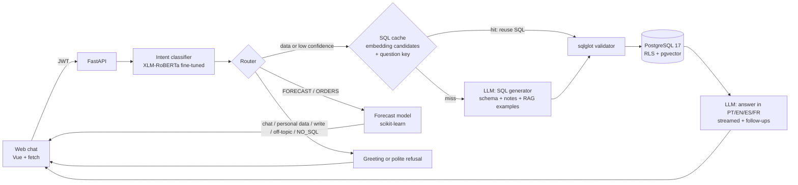

# Multistore AI Assistant

**English** · [Português](README.pt.md)


[](https://github.com/PedroPinho17/multistore-ai-assistant/actions/workflows/tests.yml)

<p align="center">
  
</p>
<p align="center"><sub>Demo at 2× speed · <a href="docs/media/demo.mp4">full-quality video</a> · fictional data, demo accounts</sub></p>

An AI assistant for a (fictional) Portuguese multi-brand restaurant group. Managers ask questions in **Portuguese, English, Spanish or French**, the assistant turns them into **SQL**, runs them on PostgreSQL with **row-level security**, and answers in plain language. It also **forecasts sales** with machine learning and suggests ingredient orders.

> All data is fictional (generated with Faker `pt_PT`). The idea comes from my BSc final project, an AI assistant built during my internship ([Projeto Final](https://github.com/PedroPinho17/PF_2024_2025)); this is a new version written from scratch.

**The group:** 3 brands, **BurgerLab** (burgers), **Café Aroma** (café) and **Gelato Mar** (ice cream), with 15 stores and warehouses, employees and shifts, products, menus, recipes and ingredients, stock, purchases, transfers and sales from Jan 2025 **until yesterday**: the history up to 16 Nov 2026 is always the same (fixed seed), and `generate_activity --extend` adds the missing days, so questions like *"this month"* never come back empty (the Docker app does it on every start).

| Answer with chart and table | Follow-up question (*"E em setembro?"*) |
|---|---|
|  |  |
| **Sales forecast (ML), dark mode** | **Store manager: RLS + the SQL used** |
|  |  |

| **Home page with a live demo conversation** | **Login (show password, demo accounts)** |
|---|---|
|  |  |
| **Profile: permissions, stats, password** | **Mobile** |
|  |  |
| **Observability dashboard (admin only)** | **Accounts: roles, scope and modules** |
|  |  |
| **Settings: theme, accent colour, language (+ app defaults for the admin)** | |
|  | |

## Features

- **Local intent classifier** (no LLM call): a fine-tuned **XLM-RoBERTa** (or, as a lighter fallback, MiniLM embeddings + LogisticRegression) routes each question to *data*, *forecast*, *orders*, *chat*, *personal data*, *write* or *off-topic*. Greetings, refusals and forecasts are answered without asking the LLM what to do; when the classifier is not confident, the LLM decides, as before.
- **Text-to-SQL** with an LLM (Groq `openai/gpt-oss-120b`), with one automatic retry when the SQL fails.
- **Safe by design** (see [Security](#security) for details):
  - SQL is parsed and validated with `sqlglot`: one `SELECT` only, no write operations, no system catalogs, and a deny-list of dangerous functions (`set_config`, `query_to_xml`, `pg_*`, `lo_*`, `dblink`…).
  - It runs as a read-only Postgres role, in a read-only transaction, with a statement timeout.
  - Personal employee data (NIF, NISS, address, birth date) is revoked at column level (GDPR).
  - The model refuses those questions, plus off-topic ones and write requests.
- **Roles enforced by PostgreSQL Row Level Security**, not by the prompt:
  - `imperador` sees the whole group.
  - `marca` (brand manager) sees only their brand.
  - `loja` (store manager) sees only their store.
- **RAG with pgvector:** similar validated question/SQL examples are retrieved (multilingual MiniLM embeddings) and added to the prompt. Accounts with the *teach* module can approve new examples through `/feedback` (the SQL must pass the validator **and** `EXPLAIN`).
- **Profitability views:** product and menu margins, plus menu-engineering price recommendations (`estrela`, `cão`, …).
- **Sales forecasting:** a HistGradientBoosting daily revenue model that uses **real weather** (Open-Meteo) and **Portuguese holidays** (MAE **102.28 €** vs **145.94 €** for a 7-day lag baseline), and ingredient order suggestions for the next 7 days.
- **Saved conversations** per user (sidebar, rename, delete) with **memory**: the last 3 turns are sent to the model, so follow-ups like *"and in September?"* or *"show it by day"* work. Inside a conversation the classifier only short-cuts forecasts and orders; everything else goes to the LLM, which sees the history (short follow-ups such as *"E no Porto?"* or *"Só para a BurgerLab"* look like chat or write requests on their own).
- **Answers in the site language** (PT/EN/ES/FR selector), whatever language the question is written in. Table headers, dates and numbers follow it too.
- **Streaming answers** (Server-Sent Events): the steps shown while waiting are the real ones (*understanding → writing SQL → querying → answering*) and the text appears as the LLM writes it. Falls back to plain `/ask` if streaming is not available.
- **Automatic alerts** when the chat opens: stores whose sales dropped (or rose) week over week, and ingredients with stock for less than half a day at the forecast pace. Thresholds are per segment (ice cream swings far more with the weather), and when the weather changed the alert says so: *"Gelato Mar Matosinhos: sales 40.7 % below the previous week… Weather: average high 17 °C vs 19 °C, 6 vs 3 rainy days."* They run with the user's RLS profile, so a store manager only sees their store.
- **Follow-up suggestions** after each answer (*"And by store?"*, *"Compare with last year"*, *"Which ingredients should I order?"*), chosen by rules from the answer type, its columns, the period asked and the user's profile. No LLM call.
- **SQL cache for repeated questions:** if someone with the same profile already asked for the same data today, in other words or another language (*"Faturação por marca em outubro de 2026"* = *"What was the revenue of each brand in October 2026?"*), the SQL is reused and the LLM call is skipped. MiniLM embeddings find the candidates; a **normalised question key** (synonyms in four languages, groupings, periods, ranking direction, and any unknown word must match) decides. Embedding distance alone can't: rewordings sit at 0.003–0.31 and different questions start at 0.016 (*more* vs *less*, *October* vs *November*). On a held-out set ([`eval/cache_pairs.json`](eval/cache_pairs.json)) the key matches **19/20 rewordings and 0/20 different questions**; a distance-only rule (≤ 0.08) matched 2/20 and reused the wrong SQL 3 times. The SQL always runs again under the asker's RLS (results are never cached). The admin dashboard shows the hit rate.
- **"Explain"** button under **› Source**: the SQL of an answer explained in plain language, in the site language (own answers only).
- **Chat-style web UI** in Vue: answers that stream in, suggestion chips, automatic bar/line charts, collapsible tables, CSV export, copy button, a collapsible **› Source** with the SQL used (or *forecast model* for ML answers), dark mode and PT/EN/ES/FR.
- **Accounts, roles and modules:** `admin > imperador > marca > loja`. Each account has modules (*data questions, forecast, orders, teach, manage accounts, observability*). You create accounts at your level or below, inside your scope, and only grant modules you have yourself. Disabling an account or removing a module takes effect on the next request (the profile is read from the DB, not from the token).
- **Observability:** every question is logged with latency, intent and confidence, SQL attempts, LLM calls and tokens; users rate answers 👍/👎. A private **admin dashboard** shows error rate, p50/p95 latency, tokens per request, satisfaction, top questions, recent errors and 👎, usage per user, and the evaluation history.
- **👎 review loop:** every 👎 lands in a **Review** page for accounts with the *teach* module (admin and Imperador only). The reviewer sees the question, the answer and the SQL used, fixes the SQL, **tests it** (runs under their own RLS, first 20 rows), and only then can **"Fix and teach"**: the pair goes through the same validator + `EXPLAIN` as `/feedback` and into the RAG examples. Follow-up questions (*"E no Porto?"*) are flagged so they get rewritten to stand alone before being stored, forecast answers can only be dismissed, and every decision is recorded (`reviewed_at`, `reviewed_by`, `taught`/`dismissed`). Everyone's feedback improves the model, always with an Imperador's approval.
- **RAG examples page** (same **Teach** page, *Examples* tab): every question → SQL example the assistant learns from, with its origin (install, chat, 👎 review, manual), who taught it and **how many times it was actually used** in a prompt. Search, filter, fix (test first, then save: same validator + `EXPLAIN`), delete wrong or duplicate ones, or add a new one for a kind of question the assistant gets wrong. A never-used example is a hint that its question doesn't look like what people ask.
- **Start suggestions and welcome by profile:** the group, a brand manager and a store manager each get questions that make sense for their scope (*"revenue of each store of my brand"*, *"my store's revenue per day last week"*), only for the modules the account has. All 60 (3 profiles × 5 × 4 languages) were run against the real stack with the matching account.
- **Continuous evaluation:** `evaluate.py` stores every run with a date (`eval/results/`, `eval/history.csv`); a manual GitHub workflow runs it against a freshly built stack.
- **FastAPI** backend split into routers (`api/routes/`), with JWT login (bcrypt), rate limiting, security headers, a **psycopg connection pool** and **API errors in four languages** (`{"detail": {"code", "message"}}`, translated from `Accept-Language`).
- **Database migrations** (`db/migrations/`, Flyway style): versioned `V###__name.sql` files run once, `R__name.sql` files re-run when they change, checksums in `schema_migrations`, an advisory lock against two runners. Docker applies them on every start.
- **Accessible UI:** labelled controls, keyboard navigation, AA contrast in both themes, screen-reader announcements and chart descriptions.
- **Tested:** 686 unit and integration tests, including attacks against the database (see [Tests](#tests)).
- **One-command Docker setup** that builds the database, data and models on first start.
- **Profile photos:** upload a photo (cropped to 160×160 WebP in the browser; the server checks the real image bytes, not just the declared type). Without one, the account shows its brand's logo, or the group's.
- **Language picker with flags** (PT/EN/FR/ES), keyboard accessible.
- **Settings page:** each account picks theme (light, dark or system), one of six accent colours or **any custom colour** from the native colour picker (the shades for buttons, links and backgrounds are derived from it and nudged just enough to keep AA contrast in both themes; a test runs that JavaScript in Node against hard colours like yellow, light grey and neon) and language, saved to the account so they follow it to any computer; the browser tab icon follows the colour. The admin sets the defaults for everyone, whether the demo accounts are shown on the home and sign-in pages, and the session length.
- **One app shell for the signed-in pages:** a sidebar with the navigation (chat, accounts, dashboard, profile) and the recent chats, an account menu (language, theme, sign out), a simple page header with that page's actions, and a consistent set of SVG line icons. Light and dark themes, phone layout with a slide-in menu.
- **Six pages** (hash router, no build step): a public **home page** with an animated demo conversation, a **login** page (show/hide password, Caps Lock warning, one-click demo accounts), the **chat**, and a **profile** page (permissions of the role, usage stats, session timer, language and theme, change password with a strength meter, delete all chats), **accounts** (create, edit modules, disable, reset password, delete) and the admin-only **observability** dashboard.

## Architecture

> Design decisions (why Groq and not Qwen, why XLM-R, why RLS with an HMAC-signed context), the life of a question and the known limits are in **[docs/ARCHITECTURE.md](docs/ARCHITECTURE.md)**.



## Security

The LLM writes SQL from user text, so the project assumes **the generated SQL may be hostile** (prompt injection) and puts the real limits in the database.

| Layer | What it does |
|---|---|
| **Signed RLS context** | The API sets `app.role`, `app.brand_id`, `app.store_id` **plus an HMAC signature** (`app.sig`) for each query. RLS policies call `ctx_role()`, which only trusts the role if the signature matches a key in `app_secret`, a table the `assistente` role cannot read. A query that calls `set_config('app.role','imperador', …)` gets **zero rows** instead of the whole group. |
| **RLS everywhere it matters** | Sales, stock, staff, transfers and purchases by store; **products, menus, recipes and their margins by brand** (a brand manager never sees another brand's prices or "remove from menu" advice). `run_query` refuses to run without a user, so a forgotten argument can't mean "see everything". |
| **Read-only role** | `assistente` has `SELECT` only, `default_transaction_read_only`, a 10 s `statement_timeout`, no access to `users` / `app_secret` and column-level `REVOKE` on personal data. The connection is also opened as read-only by the app. |
| **SQL validator** | `sqlglot` AST checks: exactly one query, no DML/DDL/`SELECT INTO`/`FOR UPDATE`, no `pg_*` / `information_schema`, and blocked functions that change session state, run SQL from a string, read files or open connections. |
| **API** | Rate limiting (10 logins / 5 min per IP, 20 questions / min and 60 conversation requests / min per user), every conversation endpoint checks ownership (404 otherwise), input length limits, constant-time login (no user enumeration), JWT with `exp`/`iat`/`sub` required and a minimum 32-char secret, generic error messages (details only in server logs), `/docs` disabled unless `ENABLE_DOCS=1`. |
| **Browser** | CSP, `X-Frame-Options: DENY`, `nosniff`, `Referrer-Policy`; CDN scripts pinned to exact versions with **Subresource Integrity**; token in `sessionStorage` (gone when the tab closes); Vue escapes all output; CSV export guards against formula injection. |
| **Infra** | No passwords in code: Postgres and the read-only role read theirs from `.env`; the database port is bound to `127.0.0.1` only. |

> Known limits (fine for a demo, worth changing for production): the rate limiter is in-memory (use Redis with several workers), JWTs cannot be revoked before they expire, and the in-DOM Vue build needs `'unsafe-eval'` in the CSP (a Vite build would remove it).

## Evaluation

There are 40 hand-written questions in `eval/questions.json`, each with a reference SQL. The levels are 10 easy, 15 medium, 10 hard and 5 refusal, in PT and EN. A question counts as correct when the generated SQL returns the same result as the reference (execution accuracy).

| Model | Easy | Medium | Hard | Refusal | Total |
|---|---|---|---|---|---|
| **Groq gpt-oss-120b** (production) | 10/10 | 15/15 | 10/10 | 5/5 | **40/40 = 100 %** |
| Qwen2.5-Coder-7B + LoRA fine-tune | 9/10 | 9/15 | 4/10 | 5/5 | **27/40 = 67.5 %** |
| Qwen2.5-Coder-1.5B + LoRA fine-tune | 5/10 | 7/15 | 1/10 | 5/5 | **18/40 = 45 %** |
| Qwen2.5-Coder-1.5B base | 5/10 | 3/15 | 1/10 | 1/5 | **10/40 = 25 %** |

For Groq, the hard questions were run 3 times each and were correct 30/30.

### Intent classifier

Before any LLM call, a small local model decides what kind of question it is: *data*, *forecast*, *orders*, *chat*, *personal data*, *write* or *off-topic*. Greetings at the start (*"Olá, quanto faturou Braga…"*) are removed first, so they don't hide a data question. Below the confidence threshold, the LLM decides as before.

- **Data:** 690 sentences in PT and EN. They come from the fine-tune pairs (split into *data*, *forecast*, *orders*, *personal data* and *write*), plus hand-written greetings, off-topic questions and short chat-style phrasings.
- **Fair evaluation:** most sentences come from templates where only the store or brand changes. A random split would leak the same template into train and test, so brands, cities and numbers are masked and the 5-fold cross-validation (`StratifiedGroupKFold`) keeps each template in a single fold. Both options use the same folds.

I compared two approaches:

- **A: MiniLM + LogisticRegression.** Frozen `paraphrase-multilingual-MiniLM-L12-v2` embeddings (the same model used for RAG) and a linear classifier. Trains locally in seconds.
- **B: fine-tuned XLM-RoBERTa base.** The whole model is fine-tuned on a free Kaggle T4 (20 epochs, class-weighted loss for the small classes).

| | A: MiniLM + LogReg | B: XLM-RoBERTa fine-tuned |
|---|---|---|
| Accuracy (5-fold, split by template) | 94.6 % | **98.6 %** |
| Macro F1 | 0.92 | **0.97** |
| Threshold used | 0.60 | 0.90 |
| Questions decided by the classifier | 92.5 % | **99.3 %** |
| Accuracy on those | 99.1 % | 99.1 % |
| CPU latency per question | a few ms | ~59 ms |
| Extra model size | none (reuses the RAG model) | ~1.1 GB |

**B is used in production** (`INTENT_MODEL=xlmr`). With the same 99.1 % accuracy on its own decisions, it handles almost every question without the LLM; ~59 ms is small next to an LLM call. A stays as a fallback: if `models/intent-xlmr` is missing (it is not in the repo), the app uses A automatically.

The training data is only Portuguese and English, but because XLM-RoBERTa was pre-trained on 100 languages, B also classifies **Spanish and French** questions correctly: 12/12 test questions (one or two per intent), all with confidence above 0.99.

What I learned: my first fine-tune run reached only 77.8 %, because using 2 GPUs halved the number of training steps and the small classes were never predicted. Training longer on one GPU with class weights fixed it. The fine-tuned model is also very confident even when it is wrong, so the threshold filters fewer errors than with A.

| Notebook | |
|---|---|
| XLM-RoBERTa intent classifier | [](https://kaggle.com/kernels/welcome?src=https://github.com/PedroPinho17/multistore-ai-assistant/blob/main/notebooks/intent_xlmr_kaggle.ipynb) |

It expects `data/intent_dataset.csv` (created by `intent.export`) uploaded as a Kaggle dataset. The full reports are in `eval/intent_report.txt` (A) and `eval/intent_report_xlmr.txt` (B).

### Real weather and holidays

The sales are generated, but the weather and holidays behind them are real, so the forecast has something real to learn from.

- **Weather:** `data/fetch_weather.py` downloads the daily max temperature and rain for the 6 districts (Porto, Braga, Aveiro, Coimbra, Lisboa, Faro) from [Open-Meteo](https://open-meteo.com/): the archive since Jan 2025, the last 10 days, and a 16-day forecast. Everything goes into `data/weather.csv`.
- **Holidays:** `data/fetch_holidays.py` writes the national holidays (`holidays` library, names in Portuguese) plus each district's municipal holiday (São João in Porto and Braga, Santo António in Lisbon, …) to `data/holidays.csv`.
- **Generator:** `data/signals.py` turns them into multipliers on the daily ticket count. Gelato Mar gains 4 % per degree above 22 °C and loses 40 % on rainy days, cafés sell a bit more when it's cold or raining and less on holidays, and burgers and ice cream go up on holidays. The generator only reads the CSVs and never calls the internet, so the data stays reproducible.
- **Forecast:** `temp_max`, `rain_mm` and `is_holiday` are model features. For future days the model uses the Open-Meteo forecast, and the district's monthly average after that.

What that does to the generated sales, measured on the database (revenue vs. the same store's average for that weekday):

| Segment | Hot day (> 28 °C) | Cold day (< 14 °C) | Rain > 10 mm | Holiday |
|---|---|---|---|---|
| Ice cream (Gelato Mar) | ×1.81 | ×0.35 | ×0.38 | ×1.41 |
| Café (Café Aroma) | ×0.94 | ×1.10 | ×1.10 | ×0.83 |
| Burgers (BurgerLab) | ×1.12 | ×0.86 | ×0.84 | ×1.27 |

Same data, same test set (last 60 days):

| Model | MAE |
|---|---|
| Baseline (same day last week) | 145.94 € |
| HistGradientBoosting, calendar + lags only | 109.90 € |
| **HistGradientBoosting + weather + holidays** | **102.28 €** |

The weather and holiday features cut the error by about 7 %. The baseline got worse than before the real weather was added (125 €), because sales now follow day-to-day weather that last week's sales can't predict.

**Keeping it fresh:** the CSVs are refreshed by hand (`uv run python -m multistore_ai_assistant.data.fetch_weather`, needs internet; `fetch_holidays` works offline). After the last day in `weather.csv` the generator uses no weather effect and the forecast uses the district's monthly average, so nothing breaks, it just gets less precise. Run `fetch_weather` every week or two, then `forecast.train`.

**Limit:** municipal holidays are set per district, from the district capital. Stores in other municipalities of the same district inherit it (e.g. the Oeiras stores get Lisbon's Santo António on 13 June, while Oeiras' own holiday is 7 June).

### Fine-tuning experiment

I wanted to see how far a small model, one that can run locally, can get with fine-tuning.

- **Data:** 510 question/SQL pairs in PT and EN, generated from templates. Each pair was verified against the database, and only queries that returned data were kept. None of the 40 eval questions are in the training data.
- **Training:** LoRA with Unsloth on a free Kaggle T4 GPU. The settings were 4-bit, r = 16, 2 epochs and `train_on_responses_only`. The notebooks expect `data/finetune_train.jsonl`, `data/finetune_valid.jsonl` and `data/eval_prompts.jsonl` uploaded as a Kaggle dataset.

| Model | Notebook |
|---|---|
| Qwen2.5-Coder-1.5B | [](https://kaggle.com/kernels/welcome?src=https://github.com/PedroPinho17/multistore-ai-assistant/blob/main/notebooks/finetune_qwen1.5b_kaggle.ipynb) |
| Qwen2.5-Coder-7B | [](https://kaggle.com/kernels/welcome?src=https://github.com/PedroPinho17/multistore-ai-assistant/blob/main/notebooks/finetune_qwen7b_kaggle.ipynb) |

**What I learned:**
- Fine-tuning almost doubled the 1.5B model (25 % → 45 %). The biggest gain was safety: refusals went from 1/5 to 5/5, where the base model wrote `DELETE` statements and looked up NIFs.
- Model size matters even more. The 7B reached 67.5 % with the same data and hallucinated far fewer columns.
- Small models still struggle with window functions, percentages and multi-period comparisons, which need CTEs. The large hosted model stays in production.

## Project structure

```
db/schema.sql          tables (applied once on a new database)
db/migrations/         V001 roles … V010 RAG examples admin, R__ views and read-only grants (db.migrate applies them)
src/multistore_ai_assistant/
  data/                fictional data generator, signals (weather + holidays → sales multipliers),
                       fetch_weather / fetch_holidays, RAG seed examples, demo passwords, create_admin
  db/                  schema reader, query runner (signed RLS context), connection pools, migrate
  assistant/           SQL generator, validator, RAG examples, answer (streaming), ask (CLI),
                       cache + question_key (SQL cache), suggest (follow-up questions)
  forecast/            dataset, training, prediction, order suggestions
  intent/              intent classifier: dataset, export, training (A), prediction (A or B)
  api/                 FastAPI app (main.py), routes/ (one router per area), errors (i18n), JWT auth,
                       permissions (roles/modules), accounts, request log, alerts, admin dashboard
                       queries, rate limiting, saved conversations, settings
  finetune/            training pairs, chat export, eval export, scoring
  observability.py     per-request trace (latency, intent, SQL attempts, LLM tokens)
  evaluate.py          execution-accuracy evaluation; eval_results.py stores the history
web/index.html         page shell (Vue + Chart.js, no build step)
web/static/js/         app.js (root store), texts.js, pages/*.js (one component per page), admin.js, settings.js
web/static/css/        base, chat, common, home, auth, pages, dialogs, shell
data/                  weather.csv (Open-Meteo, 6 districts) and holidays.csv, read by the generator and the forecast
tests/                 unit/ (no DB, no LLM) and integration/ (real Postgres + models)
Dockerfile             app image; docker/entrypoint.sh prepares DB and models on first start
docker-compose.yml     db (Postgres + pgvector) and app
docs/ARCHITECTURE.md   design decisions, request flow, security summary, known limits
docs/screenshots/      images used in this README
docs/media/            demo video (GIF + MP4)
.github/workflows/     tests (every push) and eval (manual, full stack + Groq)
docs/*.pdf             project guide (EN and PT)
eval/                  questions, results/ (one JSON per run) and history.csv
notebooks/             Kaggle notebooks: Qwen SQL fine-tuning, XLM-RoBERTa intent classifier
```

## How to run

> 🇵🇹 This guide is also available [in Portuguese](README.pt.md#como-correr). A full project guide is in [`docs/`](docs/) as PDF ([EN](docs/multistore-ai-assistant-guide-en.pdf) · [PT](docs/multistore-ai-assistant-guia-pt.pdf)).
>
> The database is not in the repository: it is built from `db/schema.sql`, `db/migrations/` and the data generator (fixed seed, so everyone gets the same data). Docker does all of this on the first start.

### Quick start with Docker (one command)

You only need Docker and a free [Groq API key](https://console.groq.com/keys).

```powershell
cp .env.example .env          # fill in POSTGRES_PASSWORD, both DB URLs, GROQ_API_KEY and JWT_SECRET
docker compose up --build
```

Open http://localhost:8001 (or the `APP_PORT` you set in `.env`). The first start creates the tables, generates the data and trains the models (a few minutes); later starts take seconds. The app container:

- waits for Postgres, then runs the migrations (`db.migrate`: only new or changed files, so security updates reach the database on every restart);
- trains only the models missing in `models/` (mounted from your machine, so an XLM-RoBERTa you already have is used);
- ships the embeddings model inside the image (works offline), runs as a non-root user and has a `/health` healthcheck;
- installs PyTorch from the CPU index on Linux, which avoids ~3 GB of CUDA libraries.

### Manual setup (for development)

You need Docker, [uv](https://docs.astral.sh/uv/) and a free [Groq API key](https://console.groq.com/keys).

```powershell
# 1. Config: fill in POSTGRES_PASSWORD, both DB URLs, GROQ_API_KEY and JWT_SECRET
cp .env.example .env
uv run python -c "import secrets; print(secrets.token_urlsafe(32))"   # generate secrets
uv sync

# 2. Database (only the db service; the app runs with uv)
docker compose up -d db
Get-Content db\schema.sql | docker compose exec -T db psql -U multistore -d multistore
uv run python -m multistore_ai_assistant.data.generate
uv run python -m multistore_ai_assistant.data.generate_activity          # history + days until yesterday
uv run python -m multistore_ai_assistant.db.migrate               # roles, RLS, views, indexes, RAG, cache…
uv run python -m multistore_ai_assistant.data.set_passwords    # demo users + read-only role password
uv run python -m multistore_ai_assistant.data.seed_examples

# 3. ML models: sales forecast + intent classifier
uv run python -m multistore_ai_assistant.forecast.train
uv run python -m multistore_ai_assistant.intent.train          # option A (B: unzip the Kaggle output into models/intent-xlmr)

# 4. Run
uv run uvicorn multistore_ai_assistant.api.main:app --port 8001
```

Open http://localhost:8001. These commands are for PowerShell; on Linux or macOS use `psql ... < db/schema.sql`.

Other commands:

```powershell
uv run python -m multistore_ai_assistant.db.migrate --status   # applied / pending migrations
uv run python -m multistore_ai_assistant.assistant.ask "Qual a faturação de cada marca em outubro de 2026?"   # CLI
uv run python -m multistore_ai_assistant.evaluate 1          # evaluation (1 run per question, saved to eval/results)
uv run python -m multistore_ai_assistant.finetune.score eval\preds_qwen7b_ft.jsonl
```

### Tests

```powershell
uv run pytest                          # everything (~30 s)
uv run pytest tests/unit               # unit tests only: no database, no LLM, no models (~3 s)
uv run pytest -m "not integration"     # skip the tests that need Postgres
uv run pytest --cov                    # with coverage
```

**686 tests** (532 unit + 154 integration), **97 % coverage** of the code that runs in the app (offline scripts for data generation, training and evaluation are excluded).

| Suite | What it checks |
|---|---|
| `tests/unit/` (461) | SQL validator (35 attack patterns), streaming events, `/explain` ownership, alert rules, follow-up suggestions, the cache question key against `eval/cache_pairs.json` (zero clashes required), API errors in four languages, the migration runner, JWT (expired, forged, `alg=none`, tampered payload), login timing, rate limiter, intent routing and retries in `ask()`, prompts sent to the LLM, conversation history, the HMAC that signs the RLS context, forecast filtering, password rules, and every API endpoint with `TestClient` (headers, 401/403/404/422/429/503) |
| `tests/integration/` (`-m integration`) | Against the real database: each role sees 15 / 6 / 1 stores; `set_config` attacks and forged signatures return **0 rows**; `assistente` cannot read `users`, `app_secret`, conversations or personal columns; it cannot write; views use `security_invoker`; conversation ownership; the schema sent to the LLM hides private tables; profile stats and password change with a temporary user; account management rules (scope, levels, modules, demo accounts), DB constraints, request log, ratings and dashboard queries, the admin CLI, the connection pool (read-only connections, no RLS context leaking between requests), migrations (idempotent, checksums), the SQL cache (same day, same profile, other languages hit, other months and *more* vs *less* miss) and alerts scoped by RLS |
| `tests/integration/` (`-m model`) | The real XLM-RoBERTa classifier on clear questions, follow-ups like *"E no Porto?"* still reach the LLM with history, RAG retrieval, the forecast model |

Integration and model tests skip themselves when Postgres or the models are not available, so `uv run pytest` works on a fresh clone.

### Configuration (`.env`)

| Variable | Purpose |
|---|---|
| `POSTGRES_PASSWORD` | Superuser password, used by Docker when it first creates the database |
| `DATABASE_URL` | Owner connection (setup scripts, login, RAG writes) |
| `READONLY_DATABASE_URL` | `assistente` role used to run generated SQL; `set_passwords` applies its password |
| `GROQ_API_KEY`, `LLM_BASE_URL`, `LLM_MODEL` | Any OpenAI-compatible endpoint works |
| `JWT_SECRET` | At least 32 random characters, or the API refuses to start |
| `ENABLE_DOCS` | `1` turns on Swagger at `/docs` |
| `APP_PORT` | Host port of the Docker app (default `8001`); use another one to run Docker and a local uvicorn side by side |
| `INTENT_MODEL` | `xlmr` (default, if `models/intent-xlmr` exists) or `minilm` |
| `HF_HUB_OFFLINE` | Optional. `1` stops Hugging Face update checks once the MiniLM model is downloaded |
| `ADMIN_USERNAME`, `ADMIN_PASSWORD` | Optional. Docker creates this **admin** account on start (12+ characters). Never a demo account; or run `python -m multistore_ai_assistant.data.create_admin <name>` |
| `DB_POOL_MAX` | Optional. Max connections per pool (default 10) |

### API

| Method | Path | Auth | Description |
|---|---|---|---|
| `GET` | `/health` | – | `{ok: true}` (Docker healthcheck) |
| `GET` | `/profile` | Bearer | Role scope (brand / store names, visible stores) and usage stats |
| `POST` | `/profile/password` | Bearer | `{current_password, new_password}`; 400 if the current one is wrong (not 401, so the UI keeps the session); 5 tries / 15 min |
| `DELETE` | `/conversations` | Bearer | Delete all the user's chats |
| `POST` | `/login` | – | `{username, password}` → `{token, user}` |
| `GET` | `/me` | Bearer | Current user, with modules (read from the DB) |
| `POST` | `/ask` | Bearer | `{question, lang: "pt"\|"en"\|"es"\|"fr", conversation_id?}` → `{answer, sql, kind, columns, rows, conversation_id, request_id, suggestions, cached?}` |
| `POST` | `/ask/stream` | Bearer | Same body; Server-Sent Events `status` → `data` → `token`… → `done` (same body as `/ask`) or `error` |
| `POST` | `/explain` | Bearer (*sql*) | `{request_id, lang}` → `{explanation}` for the SQL of one of your answers; 10 / min |
| `GET` | `/alerts` | Bearer | Sales drops/rises and low stock in your scope, text in the `Accept-Language` language (cached 10 min) |
| `POST` | `/ratings` | Bearer | `{request_id, rating: 1\|-1\|0}`: 👍 / 👎 / remove, own answers only |
| `POST` | `/feedback` | Bearer (*teach*) | Save a validated question/SQL pair for RAG |
| `GET` | `/examples` | Bearer (*teach*) | RAG examples with source, author, uses and last use |
| `POST` | `/examples/preview` | Bearer (*teach*) | `{sql}` → validated and run under your RLS; first 20 rows |
| `POST` / `PUT` | `/examples`, `/examples/{id}` | Bearer (*teach*) | `{question, sql}` → validator + `EXPLAIN`; 409 if the question already exists |
| `DELETE` | `/examples/{id}` | Bearer (*teach*) | Delete an example |
| `GET` | `/review` | Bearer (*teach*) | 👎 waiting for review: question, answer, SQL used, who asked, follow-up flag; `{pending, items}` |
| `POST` | `/review/{id}/preview` | Bearer (*teach*) | `{sql}` → validated and run under the reviewer's RLS; first 20 rows |
| `POST` | `/review/{id}/teach` | Bearer (*teach*) | `{question, sql}` → validator + `EXPLAIN`, saved to the RAG examples, leaves the list |
| `POST` | `/review/{id}/dismiss` | Bearer (*teach*) | Leaves the list without teaching |
| `GET` | `/users` | Bearer (*users*) | Accounts you can see, with `can_manage` |
| `GET` | `/users/options` | Bearer (*users*) | Roles, brands, stores and modules you may grant |
| `POST` | `/users` | Bearer (*users*) | `{username, password, role, brand_id?, store_id?, modules?}`; errors carry a `code` (`role_above`, `out_of_scope`, `module_not_yours`…) |
| `PATCH` | `/users/{id}` | Bearer (*users*) | `{modules?, active?, password?}` |
| `DELETE` | `/users/{id}` | Bearer (*users*) | Delete an account you manage |
| `GET` | `/config` | – | Public: default colour and language, whether demo accounts are shown |
| `PUT` | `/settings/me` | Bearer | `{lang?, theme?, accent?}`; `null` resets to the default |
| `GET`/`PUT` | `/settings/app` | Bearer (admin) | `{default_accent?, default_lang?, show_demo_accounts?, session_hours?}` |
| `POST`/`DELETE` | `/profile/avatar` | Bearer | Profile photo as a PNG/JPEG/WebP data URL (validated by its real bytes) |
| `GET` | `/admin/metrics?days=7` | Bearer (*observability*, admin) | Dashboard data (1–90 days) + evaluation history |
| `GET` | `/conversations` | Bearer | The user's saved conversations, newest first |
| `GET` | `/conversations/{id}` | Bearer | Messages of one conversation (with SQL) |
| `PATCH` | `/conversations/{id}` | Bearer | Rename: `{title}` |
| `DELETE` | `/conversations/{id}` | Bearer | Delete a conversation and its messages |

### Demo accounts

| User | Password | Role | Sees |
|---|---|---|---|
| `pedro` | `imperador123` | imperador | whole group |
| `gestor.burgerlab` | `marca123` | brand manager | BurgerLab only |
| `gerente.maia` | `loja123` | store manager | one store only |

The demo accounts are protected (only the admin can change them) and can create accounts below them. Because their passwords are public, the demo accounts are **read-only where it matters**: they can open the Accounts page but not create, change, disable or delete accounts (before this, a visitor logged in as `pedro` could reset the password of a real account created by the admin, or create Imperador accounts in a chain), and they can't change their own password or photo (which would lock the demo or show a photo to every visitor). `pedro` also has no *teach* module (migration V009). Teaching and account management are left to your private admin account. The admin account is not a demo account: it exists only in your private `.env`.

Ask the same question with each account to see RLS in action.

### Troubleshooting

| Error | Fix |
|---|---|
| `JWT_SECRET tem de ter pelo menos 32 caracteres` | Generate a new secret and put it in `.env` |
| `password authentication failed for user "assistente"` | Run `data.set_passwords` |
| `Falta a chave em app_secret` | `uv run python -m multistore_ai_assistant.db.migrate` |
| HTTP 429 | Rate limit hit; wait or restart uvicorn |
| Questions about *"yesterday"* or *"this month"* come back empty | `uv run python -m multistore_ai_assistant.data.generate_activity --extend` (Docker does it on start) |
| Forgot a demo password after changing it | `uv run python -m multistore_ai_assistant.data.set_passwords --reset` (without `--reset` it only fills missing passwords, so a changed password survives Docker restarts) |
| `Define POSTGRES_PASSWORD no .env` | Add `POSTGRES_PASSWORD` to `.env` (same password as in `DATABASE_URL`) |
| Port 8001 already in use | Set `APP_PORT=8002` in `.env` (Docker) or run uvicorn with `--port 8002` |
| Docker app keeps restarting | `docker compose logs app` shows which setup step failed |
| Old UI after an update | Hard refresh (Ctrl+F5); the page is served with `Cache-Control: no-cache` |
| Upgrading an existing install | Add `POSTGRES_PASSWORD` to `.env`, run `db.migrate`, then `data.set_passwords` |
| `relation "query_cache" does not exist` (or another table) | `uv run python -m multistore_ai_assistant.db.migrate` |
| Error responses | Always `{"detail": {"code", "message"}}`; the `code` is stable, the message follows `Accept-Language` |
| *"The language model has hit its usage limit"* (`llm_quota`) | The LLM provider's quota ran out (Groq's free tier: 200 000 tokens/day). It frees up over time; wait a few minutes or use a paid tier |

## Tech stack

Python 3.13 · uv · PostgreSQL 17 + pgvector · Groq (OpenAI-compatible API) · sqlglot · sentence-transformers · scikit-learn · Open-Meteo · holidays · FastAPI · Vue 3 · Docker · Unsloth / LoRA (Kaggle)

## Author

Pedro Pinho · [GitHub](https://github.com/PedroPinho17)

## License

Multistore AI Assistant project. This repository does not include a licence for reuse.
