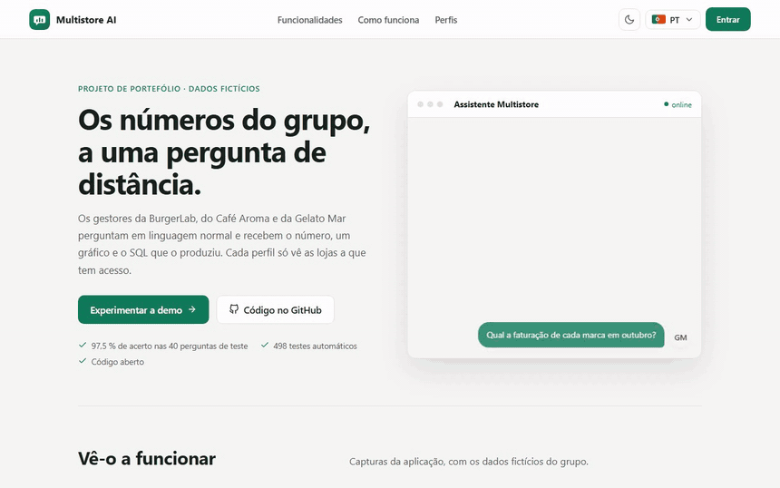
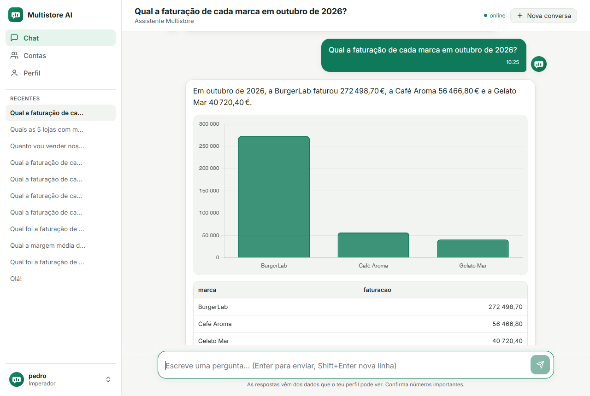
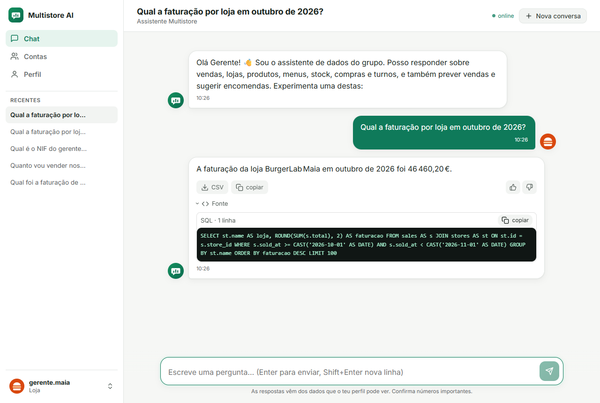
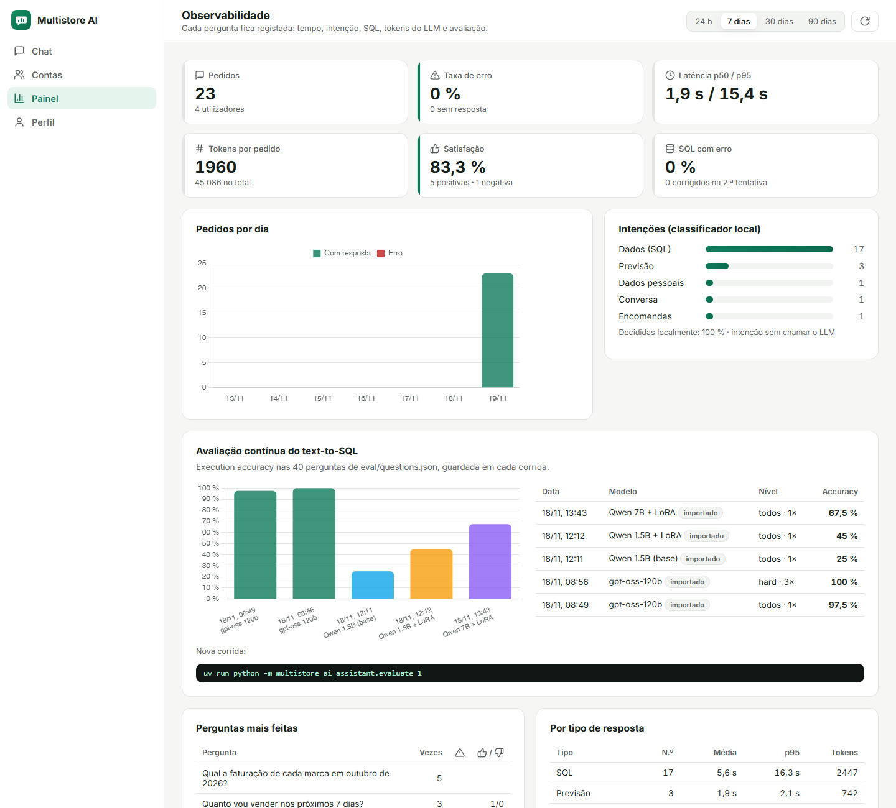
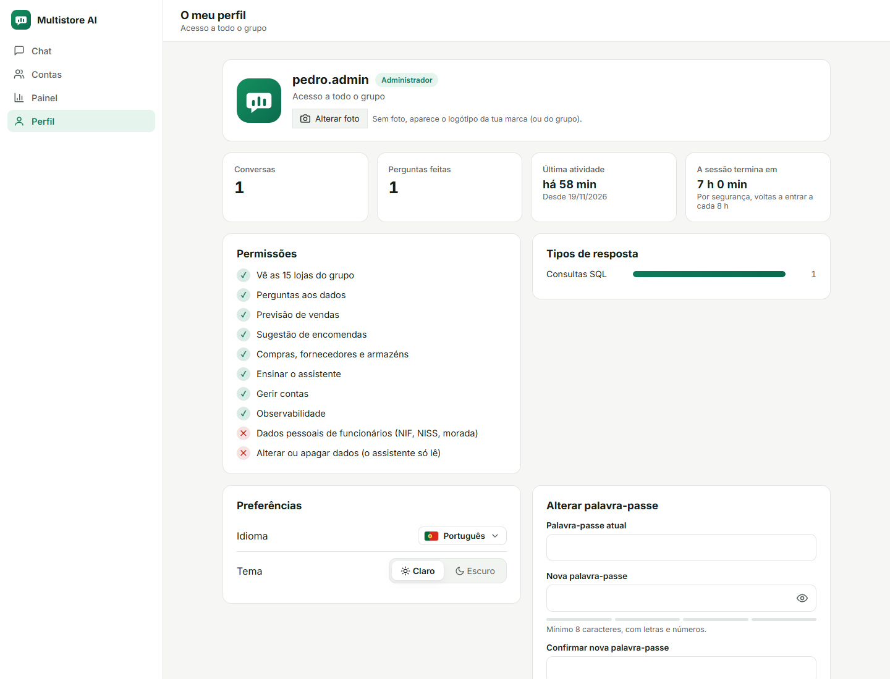
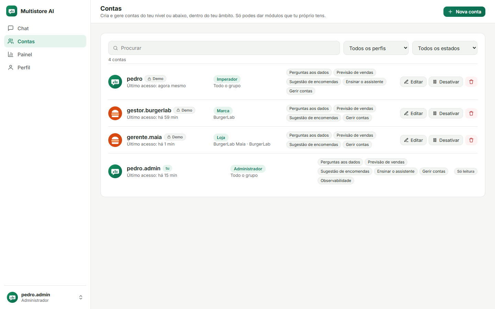
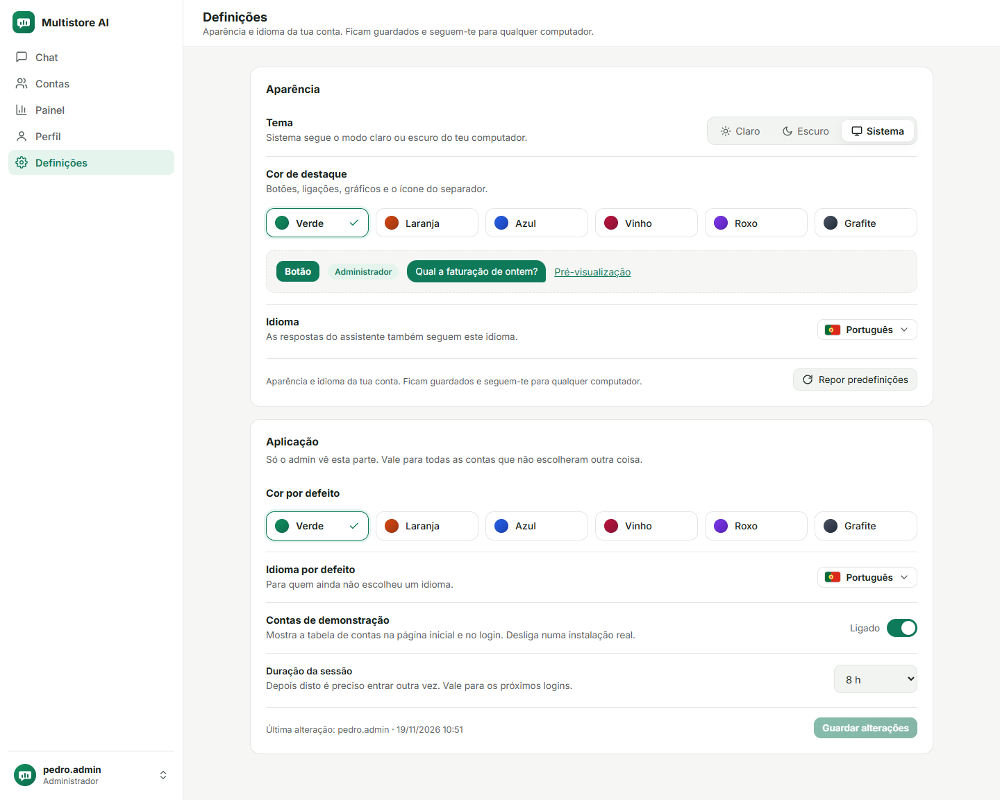
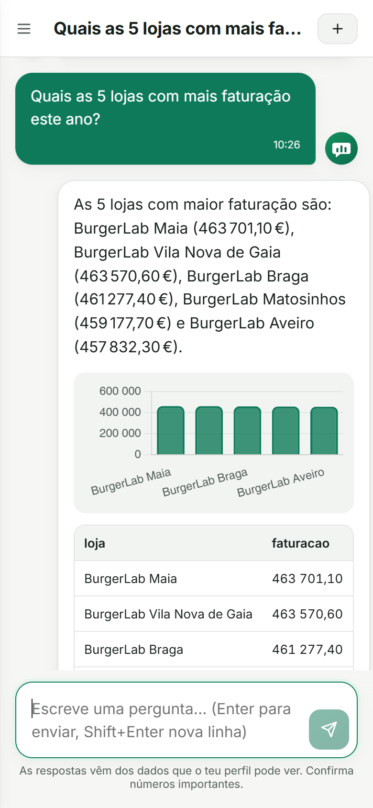
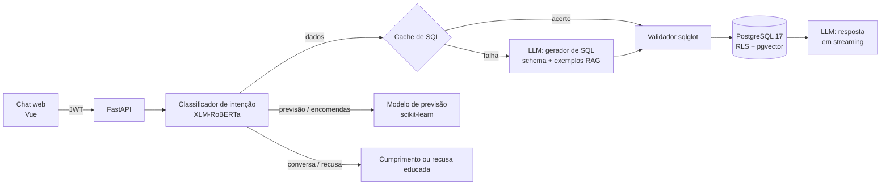

# Multistore AI Assistant

[English](README.md) · **Português**


[](https://github.com/PedroPinho17/multistore-ai-assistant/actions/workflows/tests.yml)

<p align="center">
  
</p>
<p align="center"><sub>Demonstração a 2× · <a href="docs/media/demo.mp4">vídeo em qualidade total</a> · três perfis, as mesmas perguntas, respostas diferentes (row-level security) · dados fictícios</sub></p>

Os gestores de um grupo de restauração português (fictício) fazem perguntas em **português, inglês, espanhol ou francês**. O assistente escreve o **SQL**, executa-o no PostgreSQL com **row-level security** e responde em linguagem simples, com um gráfico e a consulta que usou. Também **prevê vendas** e sugere encomendas de ingredientes.

> Todos os dados são fictícios (Faker `pt_PT`, seed fixa): 3 marcas (BurgerLab, Café Aroma, Gelato Mar), 15 lojas, armazéns, funcionários, menus, receitas, stock, compras e vendas desde janeiro de 2025 até ontem. A ideia vem do meu projeto final de licenciatura ([Projeto Final](https://github.com/PedroPinho17/PF_2024_2025)); esta é uma versão nova, escrita de raiz.

## Destaques

- **Text-to-SQL seguro por desenho.** O SQL do LLM é tratado como hostil: é analisado e validado (`sqlglot`) e depois corre com um role só de leitura, numa transação só de leitura, sob **row-level security do PostgreSQL** com um contexto assinado por HMAC. Cada perfil só vê o seu grupo, marca ou loja, diga o prompt o que disser.
- **Três perfis, um assistente.** Imperador, gestor de marca e gerente de loja fazem a mesma pergunta e recebem respostas diferentes. Os dados pessoais (NIF, NISS, moradas) estão revogados ao nível da coluna.
- **Classificador de intenção local** (XLM-RoBERTa com fine-tune) que encaminha cumprimentos, recusas, previsões e encomendas sem chamar o LLM.
- **RAG com pgvector**, **cache de SQL** para perguntas repetidas em qualquer das quatro línguas, e um **ciclo de revisão dos 👎** em que quem revê corrige o SQL, testa-o e ensina o assistente.
- **Previsão de vendas** com meteorologia real (Open-Meteo) e feriados portugueses, e sugestões de encomenda de ingredientes.
- **Aplicação web pronta a usar** (Vue, sem passo de build): respostas em streaming, gráficos, sugestões de seguimento, conversas guardadas, contas e módulos, painel de observabilidade, recuperação de password por email, modo escuro, quatro línguas, acessível e adaptada ao telemóvel.
- **Testado e reproduzível:** 845 testes (incluindo ataques à base de dados e desempenho sob RLS), instalação Docker num só comando, migrações versionadas e CI.

| Resposta com gráfico e tabela | Gerente de loja: RLS + o SQL usado |
|---|---|
|  |  |
| **Previsão de vendas (ML), modo escuro** | **Painel de observabilidade (admin)** |
|  |  |

<details>
<summary>Mais capturas: página inicial, entrada, perfil, contas, definições, telemóvel</summary>

| Página inicial | Entrada com contas de demo |
|---|---|
|  |  |
| **Perfil** | **Contas: papéis, âmbito e módulos** |
|  |  |
| **Definições** | **Telemóvel** |
|  |  |
| **Pergunta de seguimento (*"E em setembro?"*)** | |
|  | |

</details>

## Arquitetura



Decisões de desenho (porquê Groq e não um modelo local, porquê XLM-R, porquê RLS com contexto assinado), o percurso de uma pergunta e os limites conhecidos: **[docs/ARCHITECTURE.md](docs/ARCHITECTURE.md)** (em inglês).

## Segurança

| Camada | O que faz |
|---|---|
| **Contexto RLS assinado** | Cada consulta leva o perfil, a marca e a loja **e uma assinatura HMAC**. As políticas só confiam no perfil se a assinatura corresponder a uma chave que o role das consultas não consegue ler; por isso `set_config('app.role', 'imperador', …)` devolve **zero linhas**. |
| **Role só de leitura** | Só `SELECT`, transações só de leitura, limite de 10 s, sem acesso às tabelas privadas e `REVOKE` por coluna nos dados pessoais. |
| **Validador de SQL** | Uma só consulta; sem DML/DDL, catálogos de sistema nem funções que alterem a sessão, leiam ficheiros ou abram ligações. As comparações com datas são reescritas para os planos continuarem rápidos sob RLS. |
| **API** | Limites de pedidos, verificação de dono, login em tempo constante, JWT com claims obrigatórias, erros genéricos, `/docs` desligado por defeito. A recuperação de password usa tokens de uso único, válidos 30 minutos e guardados em SHA-256, e nunca revela que emails existem. |
| **Browser** | CSP, `X-Frame-Options: DENY`, `nosniff`, sem referrer, scripts de CDN fixados com Subresource Integrity, token da sessão em `sessionStorage`, proteção contra injeção de fórmulas no CSV. |
| **Infraestrutura** | Nenhum segredo no código; a porta da base de dados só está ligada a `127.0.0.1`. |

Limites conhecidos (aceitáveis numa demo): rate limiter em memória (usar Redis com vários workers), os JWT não podem ser revogados antes de expirarem, e o Vue sem build precisa de `'unsafe-eval'` na CSP.

## Resultados

**Text-to-SQL.** 40 perguntas escritas à mão (`eval/questions.json`) em PT e EN, cada uma com um SQL de referência; uma pergunta está certa quando o SQL gerado devolve o mesmo resultado (execution accuracy).

| Modelo | Fáceis | Médias | Difíceis | Recusa | Total |
|---|---|---|---|---|---|
| **Groq gpt-oss-120b** (produção) | 10/10 | 15/15 | 10/10 | 5/5 | **40/40 = 100 %** |
| Qwen2.5-Coder-7B + LoRA | 9/10 | 9/15 | 4/10 | 5/5 | 27/40 = 67,5 % |
| Qwen2.5-Coder-1.5B + LoRA | 5/10 | 7/15 | 1/10 | 5/5 | 18/40 = 45 % |
| Qwen2.5-Coder-1.5B base | 5/10 | 3/15 | 1/10 | 1/5 | 10/40 = 25 % |

No Groq, as perguntas difíceis também foram corridas 3 vezes cada: 30/30. Os modelos pequenos foram afinados com LoRA (Unsloth) numa T4 gratuita do Kaggle, com 510 pares pergunta/SQL verificados: o fine-tuning quase duplicou o modelo de 1.5B e corrigiu as recusas (1/5 → 5/5), mas window functions e comparações entre períodos continuam a precisar do modelo grande alojado. Notebooks: [Qwen 1.5B](https://kaggle.com/kernels/welcome?src=https://github.com/PedroPinho17/multistore-ai-assistant/blob/main/notebooks/finetune_qwen1.5b_kaggle.ipynb) · [Qwen 7B](https://kaggle.com/kernels/welcome?src=https://github.com/PedroPinho17/multistore-ai-assistant/blob/main/notebooks/finetune_qwen7b_kaggle.ipynb).

**Classificador de intenção.** 733 frases em PT e EN; validação cruzada de 5 folds dividida por template, para o mesmo template nunca estar no treino e no teste.

| | MiniLM + LogisticRegression | **XLM-RoBERTa com fine-tune** (produção) |
|---|---|---|
| Accuracy | 94,8 % | **97,8 %** |
| Macro F1 | 0,935 | **0,965** |
| Decididas sem o LLM (limite) | 93,0 % (0,60) | **98,1 %** (0,90) |
| Accuracy nessas | 97,5 % | **98,7 %** |

O XLM-R também classifica bem perguntas em espanhol e francês, apesar de só ter sido treinado em PT e EN. Relatórios: [`eval/intent_report_xlmr.txt`](eval/intent_report_xlmr.txt), [`eval/intent_report.txt`](eval/intent_report.txt); notebook: [XLM-RoBERTa](https://kaggle.com/kernels/welcome?src=https://github.com/PedroPinho17/multistore-ai-assistant/blob/main/notebooks/intent_xlmr_kaggle.ipynb).

**Previsão de vendas.** HistGradientBoosting sobre a faturação diária, com os últimos 60 dias de teste:

| Modelo | MAE |
|---|---|
| Baseline (mesmo dia da semana anterior) | 145,94 € |
| Calendário + lags | 109,90 € |
| **+ meteorologia e feriados reais** | **102,28 €** |

A meteorologia é real (Open-Meteo, 6 distritos) e define as vendas geradas: os gelados vendem ×1,81 nos dias quentes e ×0,38 nos de chuva; os cafés vendem mais quando está frio.

## Arranque rápido

Precisas do Docker e de uma [chave da API do Groq](https://console.groq.com/keys) gratuita.

```bash
cp .env.example .env      # preenche POSTGRES_PASSWORD, os dois URLs da BD, GROQ_API_KEY e JWT_SECRET
docker compose up --build
```

Abre http://localhost:8001. O primeiro arranque cria a base de dados (schema, migrações e dados fictícios), treina os modelos em falta e demora alguns minutos; os seguintes demoram segundos. A base de dados não está no repositório: é gerada com uma seed fixa, por isso toda a gente fica com os mesmos dados.

### Contas de demo

| Utilizador | Password | Perfil | Vê |
|---|---|---|---|
| `pedro` | `imperador123` | Imperador | o grupo todo |
| `gestor.burgerlab` | `marca123` | gestor de marca | só a BurgerLab |
| `gerente.maia` | `loja123` | gerente de loja | uma loja |

Faz a mesma pergunta com cada conta para ver o row-level security a funcionar. Como as passwords são públicas, as contas de demo são só de leitura onde importa (não mudam contas, password, foto nem email). A tua conta de admin privada vem de `ADMIN_USERNAME` / `ADMIN_PASSWORD` no `.env`.

### Configuração (`.env`)

| Variável | Para que serve |
|---|---|
| `POSTGRES_PASSWORD`, `DATABASE_URL`, `READONLY_DATABASE_URL` | Superutilizador da BD, ligação do dono e o role só de leitura que corre o SQL gerado |
| `GROQ_API_KEY`, `LLM_BASE_URL`, `LLM_MODEL` | LLM (qualquer endpoint compatível com OpenAI) |
| `GROQ_API_KEY_FALLBACK` | Opcional. Chave de uma segunda conta, usada automaticamente quando a quota da principal acaba (HTTP 429) |
| `JWT_SECRET` | Pelo menos 32 caracteres aleatórios |
| `APP_URL`, `SMTP_HOST`, `SMTP_PORT`, `SMTP_SECURITY`, `SMTP_USER`, `SMTP_PASSWORD`, `SMTP_FROM` | Opcional. Emails de recuperação de password; sem `SMTP_HOST` não se envia nada |
| `ADMIN_USERNAME`, `ADMIN_PASSWORD`, `ADMIN_EMAIL` | Opcional. Conta de admin privada criada no arranque |
| `APP_PORT`, `ENABLE_DOCS`, `INTENT_MODEL`, `DB_POOL_MAX`, `HF_HUB_OFFLINE` | Opcional. Porta, Swagger em `/docs`, classificador (`xlmr` / `minilm`), tamanho do pool, embeddings offline |
| `AVATAR_DIR` | Opcional. Pasta das fotos de perfil (por defeito `data/avatars`, um volume no Docker; fora do git) |

<details>
<summary>Instalação manual (para desenvolvimento)</summary>

Precisas do Docker, do [uv](https://docs.astral.sh/uv/) e de uma chave do Groq.

```powershell
cp .env.example .env
uv sync
docker compose up -d db
Get-Content db\schema.sql | docker compose exec -T db psql -U multistore -d multistore   # Linux/macOS: psql ... < db/schema.sql
uv run python -m multistore_ai_assistant.data.generate
uv run python -m multistore_ai_assistant.data.generate_activity    # histórico + dias até ontem
uv run python -m multistore_ai_assistant.db.migrate                # roles, RLS, vistas, índices, RAG, cache…
uv run python -m multistore_ai_assistant.data.set_passwords        # contas de demo + password do role só de leitura
uv run python -m multistore_ai_assistant.data.seed_examples
uv run python -m multistore_ai_assistant.forecast.train
uv run python -m multistore_ai_assistant.intent.train              # MiniLM; XLM-R: descompacta o output do Kaggle em models/intent-xlmr
uv run uvicorn multistore_ai_assistant.api.main:app --port 8001
```

Outros comandos: `db.migrate --status`, `assistant.ask "pergunta"` (CLI), `evaluate 1` (avaliação, guardada em `eval/results`).
</details>

### Testes

```bash
uv run pytest                  # tudo (~2 min); os testes de BD e de modelos saltam-se sozinhos se não estiverem disponíveis
uv run pytest tests/unit       # sem base de dados, sem LLM, sem modelos (~6 s)
uv run pytest --cov            # com cobertura
```

**845 testes** (651 unitários + 194 de integração), **96 % de cobertura** do código que corre na app. Cobrem o validador de SQL contra padrões de ataque, JWT forjados, todos os endpoints da API, o RLS de cada perfil na base de dados real (ataques com `set_config` e assinaturas forjadas devolvem zero linhas), tempos de consulta sob RLS, migrações, a cache de SQL, a chave de reserva do LLM, o fluxo de recuperação de password e o envio de fotos de perfil (imagens falsas, tamanho, tipo).

<details>
<summary>API</summary>

| Método | Caminho | Auth | Descrição |
|---|---|---|---|
| `POST` | `/login` | – | `{username, password}` → `{token, user}` |
| `POST` | `/password/forgot` | – | `{login, lang}` → sempre `{ok: true}`; envia um link por email se a conta existir |
| `POST` | `/password/reset` | – | `{token, new_password}` |
| `GET` | `/me`, `/profile` | Bearer | Utilizador atual, módulos, âmbito e estatísticas de uso |
| `POST` / `PUT` | `/profile/password`, `/profile/email` | Bearer | Mudar a própria password / email de recuperação (não nas contas de demo) |
| `POST` / `DELETE` | `/me/avatar` | Bearer | Foto da própria conta: PNG/JPEG/WebP em bruto até 2 MB, verificada com o Pillow e guardada como WebP 256×256 sem EXIF; `DELETE` volta às iniciais (não nas contas de demo) |
| `GET` | `/avatars/{uuid}.webp` | Bearer | Uma foto de perfil (as URLs vêm do `/me` e do `/users`, com `?v=` para o browser não mostrar a antiga) |
| `POST` | `/ask`, `/ask/stream` | Bearer | `{question, lang, conversation_id?}` → resposta, SQL, linhas, sugestões (stream: Server-Sent Events) |
| `POST` | `/explain` | Bearer (*sql*) | Explicação em linguagem simples do SQL de uma das tuas respostas |
| `GET` | `/alerts` | Bearer | Quedas/subidas de vendas e stock baixo no teu âmbito |
| `POST` | `/ratings` | Bearer | 👍 / 👎 nas tuas respostas |
| `GET` / `POST` / `PUT` / `DELETE` | `/examples…`, `/review…`, `/feedback` | Bearer (*teach*) | Exemplos RAG e ciclo de revisão dos 👎 (validador + `EXPLAIN` antes de guardar) |
| `GET` / `POST` / `PATCH` / `DELETE` | `/users…` | Bearer (*users*) | Contas do teu nível ou abaixo, no teu âmbito |
| `GET` / `PUT` | `/config`, `/settings/me`, `/settings/app` | –, Bearer, admin | Predefinições públicas, definições pessoais e da aplicação |
| `GET` | `/admin/metrics` | Bearer (admin) | Dados do painel de observabilidade |
| `GET` / `PATCH` / `DELETE` | `/conversations…` | Bearer | Conversas guardadas (só o dono) |

Os erros têm sempre a forma `{"detail": {"code", "message"}}`: o código é estável e a mensagem segue o `Accept-Language` (PT/EN/ES/FR).
</details>

<details>
<summary>Resolução de problemas</summary>

| Problema | Solução |
|---|---|
| `JWT_SECRET tem de ter pelo menos 32 caracteres` | Põe um segredo aleatório com 32+ caracteres no `.env` |
| `password authentication failed for user "assistente"` | `uv run python -m multistore_ai_assistant.data.set_passwords` |
| `relation "…" does not exist`, `Falta a chave em app_secret` | `uv run python -m multistore_ai_assistant.db.migrate` |
| Perguntas sobre *"este mês"* vêm vazias | `uv run python -m multistore_ai_assistant.data.generate_activity --extend` (o Docker faz isto no arranque) |
| *"O modelo de linguagem atingiu o limite de utilização"* | O plano gratuito do Groq dá 200 000 tokens/dia; junta `GROQ_API_KEY_FALLBACK` ou espera |
| Porta 8001 ocupada | Define `APP_PORT=8002` no `.env` |
| A app em Docker reinicia sem parar | `docker compose logs app` mostra que passo da instalação falhou |

</details>

<details>
<summary>Estrutura do projeto</summary>

```
db/schema.sql, db/migrations/   tabelas; migrações versionadas (V###) e repetíveis (R__)
src/multistore_ai_assistant/
  assistant/    gerador de SQL, validador, cliente LLM com chave de reserva, RAG, respostas, cache de SQL, sugestões
  api/          app FastAPI, rotas, autenticação, permissões, contas, recuperação de password + SMTP, alertas, observabilidade
  db/           leitor do schema, execução de consultas (contexto RLS assinado), pools de ligações, migrações
  intent/       classificador de intenção: dataset, treino, previsão
  forecast/     dataset, treino, previsão, sugestões de encomenda
  data/         gerador de dados fictícios, meteorologia e feriados, passwords de demo, conta de admin
  finetune/     pares de treino e pontuação da experiência com Qwen
web/            app Vue sem passo de build (pages/, css/)
tests/          unit/ (sem BD, sem LLM) e integration/ (Postgres real + modelos)
eval/           perguntas, resultados, relatórios do classificador
notebooks/      notebooks do Kaggle: fine-tuning de SQL com Qwen, classificador XLM-RoBERTa
docs/           ARCHITECTURE.md, guia do projeto (PDF, EN e PT), capturas, vídeo de demonstração
```

</details>

## Tecnologias

Python 3.13 · uv · PostgreSQL 17 + pgvector · Groq (API compatível com OpenAI) · sqlglot · sentence-transformers · scikit-learn · FastAPI · Vue 3 · Docker · Unsloth / LoRA (Kaggle)

## Autor

Pedro Pinho · [GitHub](https://github.com/PedroPinho17)

## Licença

Projeto Multistore AI Assistant. Este repositório não inclui uma licença de reutilização.
