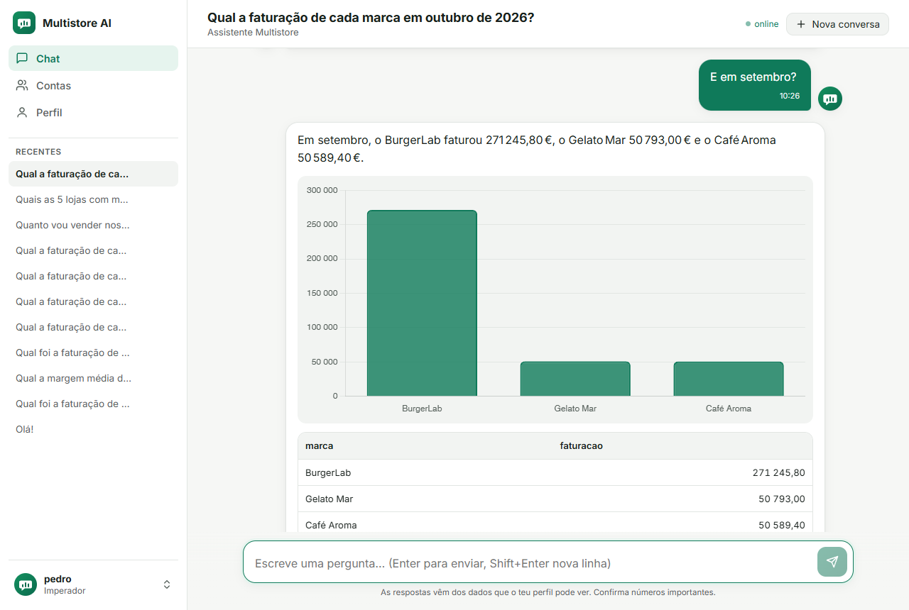
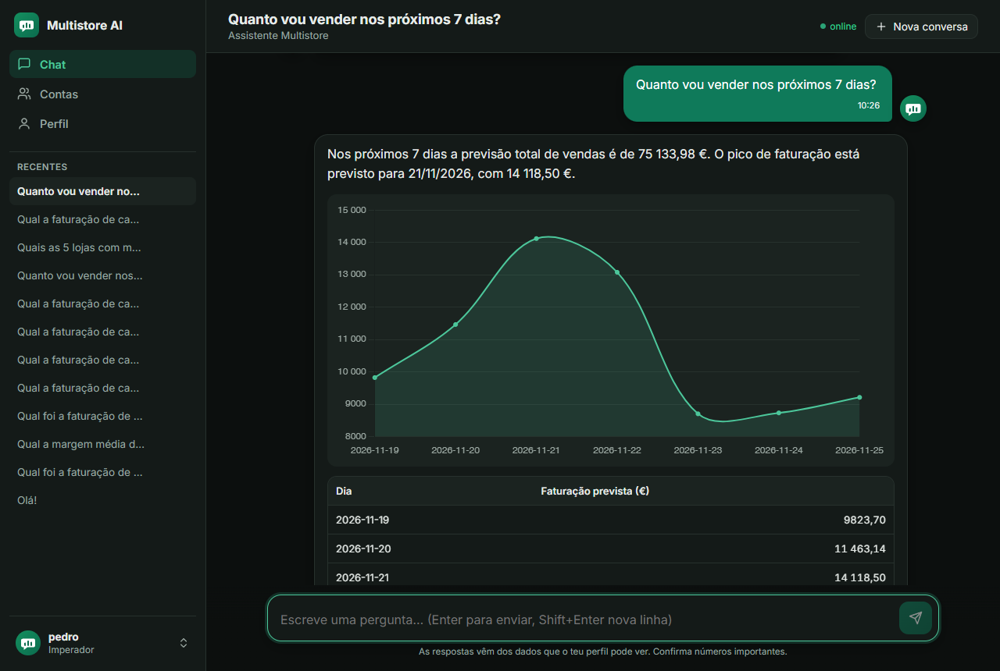
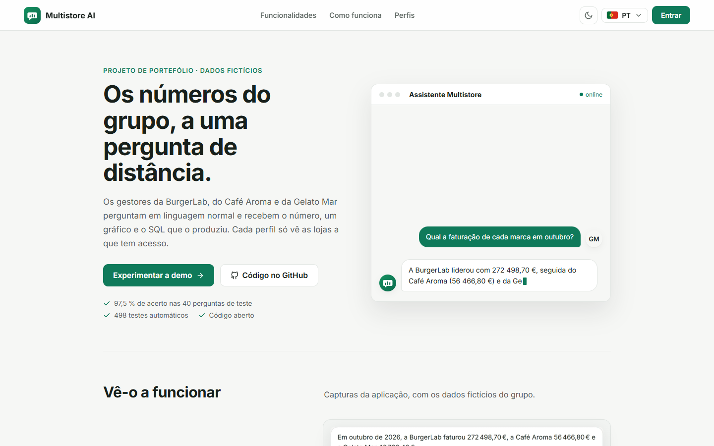
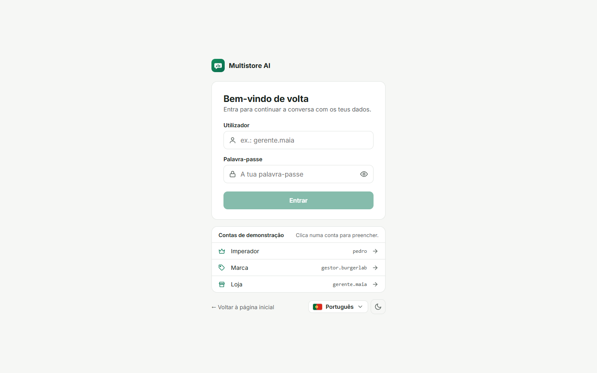
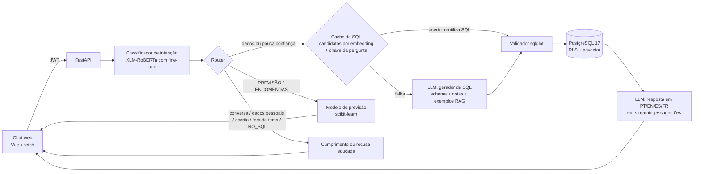

# Multistore AI Assistant

[English](README.md) · **Português**


[](https://github.com/PedroPinho17/multistore-ai-assistant/actions/workflows/tests.yml)

<p align="center">
  
</p>
<p align="center"><sub>Demonstração a 2× · <a href="docs/media/demo.mp4">vídeo em qualidade total</a> · dados fictícios, contas de demo</sub></p>

Um assistente de IA para um grupo português (fictício) de restauração com várias marcas. Os gestores fazem perguntas em **português, inglês, espanhol ou francês**, o assistente transforma-as em **SQL**, executa-as no PostgreSQL com **row-level security** e responde em linguagem simples. Também **prevê vendas** com machine learning e sugere encomendas de ingredientes.

> Todos os dados são fictícios (gerados com Faker `pt_PT`). A ideia vem do meu projeto final de licenciatura, um assistente de IA desenvolvido durante o estágio ([Projeto Final](https://github.com/PedroPinho17/PF_2024_2025)); esta é uma versão nova, escrita de raiz.

**O grupo:** 3 marcas, **BurgerLab** (hambúrgueres), **Café Aroma** (café) e **Gelato Mar** (gelados), com 15 lojas e armazéns, funcionários e turnos, produtos, menus, receitas e ingredientes, stock, compras, transferências e vendas desde janeiro de 2025 **até ontem**: o histórico até 16 de novembro de 2026 é sempre igual (seed fixa) e o `generate_activity --extend` acrescenta os dias em falta, para que perguntas como *"este mês"* nunca venham vazias (a app em Docker faz isto em cada arranque).

| Resposta com gráfico e tabela | Pergunta de seguimento (*"E em setembro?"*) |
|---|---|
|  |  |
| **Previsão de vendas (ML), modo escuro** | **Gerente de loja: RLS + o SQL usado** |
|  |  |

| **Página inicial com uma conversa de demonstração** | **Login (mostrar password, contas de demo)** |
|---|---|
|  |  |
| **Perfil: permissões, estatísticas, password** | **Telemóvel** |
|  |  |
| **Painel de observabilidade (só admin)** | **Contas: papéis, âmbito e módulos** |
|  |  |
| **Definições: tema, cor de destaque, idioma (+ predefinições da app para o admin)** | |
|  | |

## Funcionalidades

- **Classificador de intenção local** (sem chamar o LLM): um **XLM-RoBERTa** com fine-tune (ou, como alternativa mais leve, embeddings MiniLM + LogisticRegression) encaminha cada pergunta para *dados*, *previsão*, *encomendas*, *conversa*, *dados pessoais*, *escrita* ou *fora do tema*. Cumprimentos, recusas e previsões são respondidos sem perguntar ao LLM o que fazer; quando o classificador não tem confiança suficiente, decide o LLM, como antes.
- **Text-to-SQL** com um LLM (Groq `openai/gpt-oss-120b`), com uma nova tentativa automática quando o SQL falha.
- **Seguro por desenho** (detalhes em [Segurança](#segurança)):
  - O SQL é analisado e validado com `sqlglot`: só um `SELECT`, nenhuma operação de escrita, nenhum catálogo de sistema e uma lista de funções perigosas bloqueadas (`set_config`, `query_to_xml`, `pg_*`, `lo_*`, `dblink`…).
  - Corre com um role do Postgres só de leitura, numa transação só de leitura, com limite de tempo.
  - Os dados pessoais dos funcionários (NIF, NISS, morada, data de nascimento) estão revogados ao nível da coluna (RGPD).
  - O modelo recusa essas perguntas, as que estão fora do tema e os pedidos de escrita.
- **Papéis garantidos pelo Row Level Security do PostgreSQL**, não pelo prompt:
  - `imperador` vê o grupo inteiro.
  - `marca` (gestor de marca) vê só a sua marca.
  - `loja` (gerente de loja) vê só a sua loja.
- **RAG com pgvector:** exemplos pergunta/SQL validados e semelhantes são recuperados (embeddings MiniLM multilingues) e acrescentados ao prompt. Contas com o módulo *ensinar* podem aprovar novos exemplos através de `/feedback` (o SQL tem de passar no validador **e** no `EXPLAIN`).
- **Vistas de rentabilidade:** margens de produtos e menus, e recomendações de preço por menu engineering (`estrela`, `cão`, …).
- **Previsão de vendas:** um modelo HistGradientBoosting de faturação diária que usa **meteorologia real** (Open-Meteo) e **feriados portugueses** (MAE **102,28 €** contra **145,94 €** de uma baseline de 7 dias), e sugestões de encomenda de ingredientes para os próximos 7 dias.
- **Conversas guardadas** por utilizador (barra lateral, renomear, apagar) com **memória**: as últimas 3 trocas são enviadas ao modelo, por isso perguntas de seguimento como *"e em setembro?"* ou *"mostra por dia"* funcionam. Dentro de uma conversa, o classificador só despacha diretamente previsões e encomendas; tudo o resto vai para o LLM, que vê o histórico (perguntas curtas como *"E no Porto?"* ou *"Só para a BurgerLab"* parecem, sozinhas, conversa ou pedidos de escrita).
- **Responde no idioma do site** (seletor PT/EN/ES/FR), seja qual for o idioma da pergunta. Os cabeçalhos das tabelas, as datas e os números também o seguem.
- **Respostas em streaming** (Server-Sent Events): os passos mostrados durante a espera são os reais (*a perceber → a escrever o SQL → a consultar → a responder*) e o texto aparece à medida que o LLM o escreve. Se o streaming não estiver disponível, usa o `/ask` normal.
- **Alertas automáticos** ao abrir o chat: lojas cujas vendas caíram (ou subiram) de uma semana para a outra, e ingredientes com stock para menos de meio dia ao ritmo previsto. Os limites são por segmento (os gelados variam muito mais com o tempo) e, quando o tempo mudou, o alerta diz isso: *"Gelato Mar Matosinhos: vendas 40,7 % abaixo da semana anterior… Tempo: máxima média de 17 °C contra 19 °C, 6 contra 3 dias de chuva."* Correm com o perfil RLS do utilizador, por isso um gerente de loja só vê a sua loja.
- **Sugestões de seguimento** depois de cada resposta (*"E por loja?"*, *"Compara com o ano passado"*, *"Que ingredientes devo encomendar?"*), escolhidas por regras a partir do tipo de resposta, das colunas, do período pedido e do perfil do utilizador. Sem chamar o LLM.
- **Cache de SQL para perguntas repetidas:** se alguém com o mesmo perfil já pediu os mesmos dados hoje, por outras palavras ou noutro idioma (*"Faturação por marca em outubro de 2026"* = *"What was the revenue of each brand in October 2026?"*), o SQL é reutilizado e a chamada ao LLM é evitada. Os embeddings MiniLM encontram os candidatos; uma **chave normalizada da pergunta** (sinónimos em quatro idiomas, agrupamentos, períodos, sentido da ordenação, e qualquer palavra desconhecida tem de coincidir) decide. Só a distância entre embeddings não chega: reformulações ficam entre 0,003 e 0,31 e perguntas diferentes começam em 0,016 (*mais* vs *menos*, *outubro* vs *novembro*). Num conjunto de teste à parte ([`eval/cache_pairs.json`](eval/cache_pairs.json)), a chave acerta **19/20 reformulações e 0/20 perguntas diferentes**; uma regra só por distância (≤ 0,08) acertou 2/20 e reutilizou o SQL errado 3 vezes. O SQL volta sempre a correr com o RLS de quem pergunta (os resultados nunca ficam em cache). O painel de admin mostra a taxa de acerto.
- **Botão "Explicar"** em **› Fonte**: o SQL de uma resposta explicado em linguagem simples, no idioma do site (só nas próprias respostas).
- **Interface web estilo chat** em Vue: respostas que aparecem em streaming, sugestões em botões, gráficos de barras/linhas automáticos, tabelas recolhíveis, exportação para CSV, botão de copiar, uma secção **› Fonte** recolhível com o SQL usado (ou *modelo de previsão* nas respostas de ML), modo escuro e PT/EN/ES/FR.
- **Contas, papéis e módulos:** `admin > imperador > marca > loja`. Cada conta tem módulos (*perguntas sobre dados, previsão, encomendas, ensinar, gerir contas, observabilidade*). Cada um cria contas ao seu nível ou abaixo, dentro do seu âmbito, e só pode dar módulos que também tem. Desativar uma conta ou retirar um módulo tem efeito no pedido seguinte (o perfil é lido da BD, não do token).
- **Observabilidade:** cada pergunta é registada com latência, intenção e confiança, tentativas de SQL, chamadas ao LLM e tokens; os utilizadores avaliam as respostas com 👍/👎. Um **painel de admin** privado mostra taxa de erro, latência p50/p95, tokens por pedido, satisfação, perguntas mais frequentes, erros e 👎 recentes, uso por utilizador e o histórico de avaliações.
- **Ciclo de revisão dos 👎:** cada 👎 vai parar a uma página de **Revisão** para contas com o módulo *ensinar* (só admin e Imperador). Quem revê vê a pergunta, a resposta e o SQL usado, corrige o SQL, **testa-o** (corre com o seu próprio RLS, primeiras 20 linhas) e só então pode **"Corrigir e ensinar"**: o par passa pelo mesmo validador + `EXPLAIN` que o `/feedback` e entra nos exemplos do RAG. As perguntas de seguimento (*"E no Porto?"*) ficam assinaladas para serem reescritas de forma autónoma antes de serem guardadas, as respostas de previsão só podem ser descartadas, e cada decisão fica registada (`reviewed_at`, `reviewed_by`, `taught`/`dismissed`). O feedback de todos melhora o modelo, sempre com a aprovação de um Imperador.
- **Página de exemplos RAG** (mesma página **Ensinar**, separador *Exemplos*): todos os exemplos pergunta → SQL com que o assistente aprende, com a origem (instalação, chat, revisão de 👎, manual), quem o ensinou e **quantas vezes foi mesmo usado** num prompt. Pesquisar, filtrar, corrigir (testar primeiro, depois guardar: mesmo validador + `EXPLAIN`), apagar exemplos errados ou duplicados, ou acrescentar um novo para um tipo de pergunta em que o assistente falha. Um exemplo nunca usado é sinal de que a pergunta não se parece com o que as pessoas perguntam.
- **Sugestões iniciais e boas-vindas por perfil:** o grupo, um gestor de marca e um gerente de loja recebem perguntas que fazem sentido no seu âmbito (*"faturação de cada loja da minha marca"*, *"faturação da minha loja por dia na semana passada"*), só para os módulos que a conta tem. As 60 (3 perfis × 5 × 4 idiomas) foram testadas na aplicação real com a conta correspondente.
- **Avaliação contínua:** o `evaluate.py` guarda cada execução com data (`eval/results/`, `eval/history.csv`); um workflow manual do GitHub corre-a numa stack acabada de construir.
- **Backend FastAPI** dividido em routers (`api/routes/`), com login JWT (bcrypt), rate limiting, cabeçalhos de segurança, um **pool de ligações psycopg** e **erros da API em quatro idiomas** (`{"detail": {"code", "message"}}`, traduzidos a partir do `Accept-Language`).
- **Migrações da base de dados** (`db/migrations/`, estilo Flyway): os ficheiros versionados `V###__nome.sql` correm uma vez, os `R__nome.sql` voltam a correr quando mudam, checksums em `schema_migrations` e um advisory lock contra duas execuções em simultâneo. O Docker aplica-as em cada arranque.
- **Interface acessível:** controlos com rótulo, navegação por teclado, contraste AA nos dois temas, anúncios para leitores de ecrã e descrições dos gráficos.
- **Testado:** 686 testes unitários e de integração, incluindo ataques à base de dados (ver [Testes](#testes)).
- **Instalação com Docker num só comando**, que cria a base de dados, os dados e os modelos no primeiro arranque.
- **Fotos de perfil:** carregar uma foto (recortada para 160×160 WebP no browser; o servidor verifica os bytes reais da imagem, não só o tipo declarado). Sem foto, a conta mostra o logótipo da sua marca, ou o do grupo.
- **Seletor de idioma com bandeiras** (PT/EN/FR/ES), acessível por teclado.
- **Página de definições:** cada conta escolhe o tema (claro, escuro ou do sistema), uma de seis cores de destaque ou **qualquer cor personalizada** no seletor de cores nativo (os tons dos botões, ligações e fundos derivam dela e são ajustados só o necessário para manter contraste AA nos dois temas; um teste corre esse JavaScript em Node com cores difíceis como amarelo, cinzento claro e néon) e o idioma, guardados na conta para a seguirem em qualquer computador; o ícone do separador do browser segue a cor. O admin define as predefinições para todos, se as contas de demo aparecem na página inicial e no login, e a duração da sessão.
- **Uma estrutura comum para as páginas com sessão iniciada:** barra lateral com a navegação (chat, contas, painel, perfil) e as conversas recentes, menu da conta (idioma, tema, terminar sessão), um cabeçalho simples com as ações da página e um conjunto coerente de ícones SVG de linha. Temas claro e escuro, layout de telemóvel com menu deslizante.
- **Seis páginas** (router por hash, sem passo de build): uma **página inicial** pública com uma conversa de demonstração animada, uma página de **login** (mostrar/esconder password, aviso de Caps Lock, contas de demo com um clique), o **chat**, e uma página de **perfil** (permissões do papel, estatísticas de uso, tempo de sessão, idioma e tema, mudar a password com medidor de força, apagar todas as conversas), **contas** (criar, editar módulos, desativar, repor password, apagar) e o painel de **observabilidade**, só para o admin.

## Arquitetura

> As decisões de desenho (porquê Groq e não Qwen, porquê XLM-R, porquê RLS com um contexto assinado por HMAC), o percurso de uma pergunta e os limites conhecidos estão em **[docs/ARCHITECTURE.md](docs/ARCHITECTURE.md)** (em inglês).



## Segurança

O LLM escreve SQL a partir do texto do utilizador, por isso o projeto parte do princípio de que **o SQL gerado pode ser hostil** (prompt injection) e põe os limites reais na base de dados.

| Camada | O que faz |
|---|---|
| **Contexto RLS assinado** | A API define `app.role`, `app.brand_id`, `app.store_id` **e uma assinatura HMAC** (`app.sig`) em cada consulta. As políticas RLS chamam `ctx_role()`, que só confia no papel se a assinatura corresponder a uma chave em `app_secret`, uma tabela que o role `assistente` não consegue ler. Uma consulta que chame `set_config('app.role','imperador', …)` recebe **zero linhas** em vez do grupo inteiro. |
| **RLS onde importa** | Vendas, stock, pessoal, transferências e compras por loja; **produtos, menus, receitas e as suas margens por marca** (um gestor de marca nunca vê os preços de outra marca nem conselhos de "retirar do menu"). O `run_query` recusa correr sem utilizador, por isso um argumento esquecido não pode significar "ver tudo". |
| **Role só de leitura** | O `assistente` só tem `SELECT`, `default_transaction_read_only`, `statement_timeout` de 10 s, nenhum acesso a `users` / `app_secret` e `REVOKE` ao nível da coluna nos dados pessoais. A app também abre a ligação em modo só de leitura. |
| **Validador de SQL** | Verificações na AST com `sqlglot`: exatamente uma consulta, nada de DML/DDL/`SELECT INTO`/`FOR UPDATE`, nada de `pg_*` / `information_schema`, e funções bloqueadas que alteram o estado da sessão, executam SQL a partir de texto, leem ficheiros ou abrem ligações. |
| **API** | Rate limiting (10 logins / 5 min por IP, 20 perguntas / min e 60 pedidos de conversas / min por utilizador), todos os endpoints de conversas verificam o dono (404 caso contrário), limites de tamanho nas entradas, login em tempo constante (sem enumeração de utilizadores), JWT com `exp`/`iat`/`sub` obrigatórios e segredo com pelo menos 32 caracteres, mensagens de erro genéricas (detalhes só nos logs do servidor), `/docs` desligado salvo com `ENABLE_DOCS=1`. |
| **Browser** | CSP, `X-Frame-Options: DENY`, `nosniff`, `Referrer-Policy`; scripts de CDN fixados em versões exatas com **Subresource Integrity**; token em `sessionStorage` (desaparece ao fechar o separador); o Vue escapa todo o output; a exportação para CSV protege contra injeção de fórmulas. |
| **Infraestrutura** | Nenhuma password no código: o Postgres e o role só de leitura leem as suas do `.env`; a porta da base de dados só está ligada a `127.0.0.1`. |

> Limites conhecidos (aceitáveis numa demo, a mudar em produção): o rate limiter é em memória (usar Redis com vários workers), os JWT não podem ser revogados antes de expirarem, e o Vue sem build precisa de `'unsafe-eval'` na CSP (um build com Vite resolvia isso).

## Avaliação

Há 40 perguntas escritas à mão em `eval/questions.json`, cada uma com um SQL de referência: 10 fáceis, 15 médias, 10 difíceis e 5 de recusa, em PT e EN. Uma pergunta conta como certa quando o SQL gerado devolve o mesmo resultado que a referência (execution accuracy).

| Modelo | Fáceis | Médias | Difíceis | Recusa | Total |
|---|---|---|---|---|---|
| **Groq gpt-oss-120b** (produção) | 10/10 | 15/15 | 10/10 | 5/5 | **40/40 = 100 %** |
| Qwen2.5-Coder-7B + fine-tune LoRA | 9/10 | 9/15 | 4/10 | 5/5 | **27/40 = 67,5 %** |
| Qwen2.5-Coder-1.5B + fine-tune LoRA | 5/10 | 7/15 | 1/10 | 5/5 | **18/40 = 45 %** |
| Qwen2.5-Coder-1.5B base | 5/10 | 3/15 | 1/10 | 1/5 | **10/40 = 25 %** |

No Groq, as perguntas difíceis foram corridas 3 vezes cada e acertou 30/30.

### Classificador de intenção

Antes de qualquer chamada ao LLM, um pequeno modelo local decide que tipo de pergunta é: *dados*, *previsão*, *encomendas*, *conversa*, *dados pessoais*, *escrita* ou *fora do tema*. Os cumprimentos no início (*"Olá, quanto faturou Braga…"*) são retirados primeiro, para não esconderem uma pergunta sobre dados. Abaixo do limite de confiança, decide o LLM, como antes.

- **Dados:** 690 frases em PT e EN. Vêm dos pares do fine-tune (divididos em *dados*, *previsão*, *encomendas*, *dados pessoais* e *escrita*), mais cumprimentos, perguntas fora do tema e frases curtas de conversa escritos à mão.
- **Avaliação justa:** a maioria das frases vem de templates onde só muda a loja ou a marca. Uma divisão aleatória punha o mesmo template no treino e no teste, por isso as marcas, cidades e números são mascarados e a validação cruzada de 5 folds (`StratifiedGroupKFold`) mantém cada template num só fold. As duas opções usam os mesmos folds.

Comparei duas abordagens:

- **A: MiniLM + LogisticRegression.** Embeddings congelados do `paraphrase-multilingual-MiniLM-L12-v2` (o mesmo modelo usado no RAG) e um classificador linear. Treina localmente em segundos.
- **B: XLM-RoBERTa base com fine-tune.** O modelo inteiro é afinado numa T4 gratuita do Kaggle (20 épocas, loss com pesos por classe para as classes pequenas).

| | A: MiniLM + LogReg | B: XLM-RoBERTa com fine-tune |
|---|---|---|
| Accuracy (5 folds, divisão por template) | 94,6 % | **98,6 %** |
| Macro F1 | 0,92 | **0,97** |
| Limite usado | 0,60 | 0,90 |
| Perguntas decididas pelo classificador | 92,5 % | **99,3 %** |
| Accuracy nessas | 99,1 % | 99,1 % |
| Latência em CPU por pergunta | poucos ms | ~59 ms |
| Tamanho extra do modelo | nenhum (reutiliza o modelo do RAG) | ~1,1 GB |

**Em produção usa-se o B** (`INTENT_MODEL=xlmr`). Com a mesma accuracy de 99,1 % nas suas decisões, trata quase todas as perguntas sem o LLM; ~59 ms é pouco ao lado de uma chamada ao LLM. O A fica como alternativa: se `models/intent-xlmr` não existir (não está no repositório), a app usa o A automaticamente.

Os dados de treino são só em português e inglês, mas como o XLM-RoBERTa foi pré-treinado em 100 idiomas, o B também classifica bem perguntas em **espanhol e francês**: 12/12 perguntas de teste (uma ou duas por intenção), todas com confiança acima de 0,99.

O que aprendi: a primeira execução do fine-tune só chegou a 77,8 %, porque usar 2 GPUs reduziu para metade o número de passos de treino e as classes pequenas nunca eram previstas. Treinar mais tempo numa só GPU, com pesos por classe, resolveu. O modelo afinado também é muito confiante mesmo quando erra, por isso o limite filtra menos erros do que no A.

| Notebook | |
|---|---|
| Classificador de intenção XLM-RoBERTa | [](https://kaggle.com/kernels/welcome?src=https://github.com/PedroPinho17/multistore-ai-assistant/blob/main/notebooks/intent_xlmr_kaggle.ipynb) |

Espera o `data/intent_dataset.csv` (criado pelo `intent.export`) carregado como dataset do Kaggle. Os relatórios completos estão em `eval/intent_report.txt` (A) e `eval/intent_report_xlmr.txt` (B).

### Meteorologia e feriados reais

As vendas são geradas, mas a meteorologia e os feriados por trás delas são reais, para que a previsão tenha algo real com que aprender.

- **Meteorologia:** o `data/fetch_weather.py` descarrega a temperatura máxima diária e a chuva dos 6 distritos (Porto, Braga, Aveiro, Coimbra, Lisboa, Faro) do [Open-Meteo](https://open-meteo.com/): o arquivo desde janeiro de 2025, os últimos 10 dias e uma previsão a 16 dias. Tudo vai para `data/weather.csv`.
- **Feriados:** o `data/fetch_holidays.py` escreve os feriados nacionais (biblioteca `holidays`, nomes em português) e o feriado municipal de cada distrito (São João no Porto e em Braga, Santo António em Lisboa, …) em `data/holidays.csv`.
- **Gerador:** o `data/signals.py` transforma-os em multiplicadores do número diário de talões. A Gelato Mar ganha 4 % por cada grau acima de 22 °C e perde 40 % nos dias de chuva, os cafés vendem um pouco mais quando está frio ou chove e menos nos feriados, e os hambúrgueres e gelados sobem nos feriados. O gerador só lê os CSV e nunca vai à internet, por isso os dados continuam reproduzíveis.
- **Previsão:** `temp_max`, `rain_mm` e `is_holiday` são features do modelo. Para os dias futuros, o modelo usa a previsão do Open-Meteo e, depois disso, a média mensal do distrito.

O efeito nas vendas geradas, medido na base de dados (faturação contra a média da mesma loja nesse dia da semana):

| Segmento | Dia quente (> 28 °C) | Dia frio (< 14 °C) | Chuva > 10 mm | Feriado |
|---|---|---|---|---|
| Gelados (Gelato Mar) | ×1,81 | ×0,35 | ×0,38 | ×1,41 |
| Café (Café Aroma) | ×0,94 | ×1,10 | ×1,10 | ×0,83 |
| Hambúrgueres (BurgerLab) | ×1,12 | ×0,86 | ×0,84 | ×1,27 |

Mesmos dados, mesmo conjunto de teste (últimos 60 dias):

| Modelo | MAE |
|---|---|
| Baseline (mesmo dia da semana anterior) | 145,94 € |
| HistGradientBoosting, só calendário + lags | 109,90 € |
| **HistGradientBoosting + meteorologia + feriados** | **102,28 €** |

As features de meteorologia e feriados reduzem o erro em cerca de 7 %. A baseline ficou pior do que antes de juntar a meteorologia real (125 €), porque as vendas passaram a seguir o tempo de cada dia, que as vendas da semana anterior não conseguem prever.

**Manter atualizado:** os CSV são atualizados à mão (`uv run python -m multistore_ai_assistant.data.fetch_weather`, precisa de internet; o `fetch_holidays` funciona offline). Depois do último dia em `weather.csv`, o gerador não aplica efeito de tempo e a previsão usa a média mensal do distrito, por isso nada parte, só fica menos preciso. Corre o `fetch_weather` a cada uma ou duas semanas e depois o `forecast.train`.

**Limite:** os feriados municipais são definidos por distrito, a partir da capital de distrito. As lojas noutros concelhos do mesmo distrito herdam-no (por exemplo, as lojas de Oeiras ficam com o Santo António de Lisboa a 13 de junho, quando o feriado de Oeiras é a 7 de junho).

### Experiência de fine-tuning

Queria ver até onde um modelo pequeno, que consegue correr localmente, chega com fine-tuning.

- **Dados:** 510 pares pergunta/SQL em PT e EN, gerados a partir de templates. Cada par foi verificado na base de dados e só ficaram as consultas que devolviam dados. Nenhuma das 40 perguntas da avaliação está nos dados de treino.
- **Treino:** LoRA com Unsloth numa GPU T4 gratuita do Kaggle, com 4 bits, r = 16, 2 épocas e `train_on_responses_only`. Os notebooks esperam `data/finetune_train.jsonl`, `data/finetune_valid.jsonl` e `data/eval_prompts.jsonl` carregados como dataset do Kaggle.

| Modelo | Notebook |
|---|---|
| Qwen2.5-Coder-1.5B | [](https://kaggle.com/kernels/welcome?src=https://github.com/PedroPinho17/multistore-ai-assistant/blob/main/notebooks/finetune_qwen1.5b_kaggle.ipynb) |
| Qwen2.5-Coder-7B | [](https://kaggle.com/kernels/welcome?src=https://github.com/PedroPinho17/multistore-ai-assistant/blob/main/notebooks/finetune_qwen7b_kaggle.ipynb) |

**O que aprendi:**
- O fine-tuning quase duplicou o modelo de 1.5B (25 % → 45 %). O maior ganho foi na segurança: as recusas passaram de 1/5 para 5/5, quando o modelo base escrevia `DELETE` e ia procurar NIFs.
- O tamanho do modelo conta ainda mais. O 7B chegou a 67,5 % com os mesmos dados e inventou muito menos colunas.
- Os modelos pequenos continuam a ter dificuldade com window functions, percentagens e comparações entre vários períodos, que precisam de CTEs. Em produção fica o modelo grande alojado.

## Estrutura do projeto

```
db/schema.sql          tabelas (aplicado uma vez numa base de dados nova)
db/migrations/         V001 roles … V010 admin de exemplos RAG, R__ vistas e permissões só de leitura (aplicadas pelo db.migrate)
src/multistore_ai_assistant/
  data/                gerador de dados fictícios, sinais (meteorologia + feriados → multiplicadores de vendas),
                       fetch_weather / fetch_holidays, exemplos RAG iniciais, passwords de demo, create_admin
  db/                  leitor do schema, execução de consultas (contexto RLS assinado), pools de ligações, migrate
  assistant/           gerador de SQL, validador, exemplos RAG, resposta (streaming), ask (CLI),
                       cache + question_key (cache de SQL), suggest (perguntas de seguimento)
  forecast/            dataset, treino, previsão, sugestões de encomenda
  intent/              classificador de intenção: dataset, export, treino (A), previsão (A ou B)
  api/                 app FastAPI (main.py), routes/ (um router por área), erros (i18n), autenticação JWT,
                       permissões (papéis/módulos), contas, registo de pedidos, alertas, consultas do
                       painel de admin, rate limiting, conversas guardadas, definições
  finetune/            pares de treino, export para chat, export da avaliação, pontuação
  observability.py     traço por pedido (latência, intenção, tentativas de SQL, tokens do LLM)
  evaluate.py          avaliação por execution accuracy; eval_results.py guarda o histórico
web/index.html         estrutura da página (Vue + Chart.js, sem passo de build)
web/static/js/         app.js (store principal), texts.js, pages/*.js (um componente por página), admin.js, settings.js
web/static/css/        base, chat, common, home, auth, pages, dialogs, shell
data/                  weather.csv (Open-Meteo, 6 distritos) e holidays.csv, lidos pelo gerador e pela previsão
tests/                 unit/ (sem BD, sem LLM) e integration/ (Postgres real + modelos)
Dockerfile             imagem da app; docker/entrypoint.sh prepara a BD e os modelos no primeiro arranque
docker-compose.yml     db (Postgres + pgvector) e app
docs/ARCHITECTURE.md   decisões de desenho, percurso dos pedidos, resumo de segurança, limites conhecidos
docs/*.pdf             guia do projeto (EN e PT)
docs/screenshots/      imagens usadas neste README
docs/media/            vídeo de demonstração (GIF + MP4)
.github/workflows/     testes (em cada push) e avaliação (manual, stack completa + Groq)
eval/                  perguntas, results/ (um JSON por execução) e history.csv
notebooks/             notebooks do Kaggle: fine-tuning de SQL com Qwen, classificador de intenção XLM-RoBERTa
```

## Como correr

> O guia completo do projeto também está em PDF: [português](docs/multistore-ai-assistant-guia-pt.pdf) · [inglês](docs/multistore-ai-assistant-guide-en.pdf).
>
> **A base de dados não está no repositório:** é criada a partir do `db/schema.sql`, das `db/migrations/` e do gerador de dados (seed fixa, por isso toda a gente fica com os mesmos dados). O Docker faz tudo isto no primeiro arranque.

### Arranque rápido com Docker (um comando)

Só precisas do Docker e de uma [chave da API do Groq](https://console.groq.com/keys) gratuita.

```powershell
cp .env.example .env          # preenche POSTGRES_PASSWORD, os dois URLs da BD, GROQ_API_KEY e JWT_SECRET
docker compose up --build
```

Abre http://localhost:8001 (ou a `APP_PORT` que definiste no `.env`). O primeiro arranque cria as tabelas, gera os dados e treina os modelos (alguns minutos); os seguintes demoram segundos. O contentor da app:

- espera pelo Postgres e depois corre as migrações (`db.migrate`: só ficheiros novos ou alterados, por isso as atualizações de segurança chegam à base de dados em cada reinício);
- treina só os modelos que faltam em `models/` (montada a partir do teu computador, por isso um XLM-RoBERTa que já tenhas é usado);
- traz o modelo de embeddings dentro da imagem (funciona offline), corre com um utilizador sem privilégios de root e tem um healthcheck em `/health`;
- instala o PyTorch a partir do índice de CPU em Linux, o que evita ~3 GB de bibliotecas CUDA.

### Instalação manual (para desenvolvimento)

Precisas do Docker, do [uv](https://docs.astral.sh/uv/) e de uma [chave da API do Groq](https://console.groq.com/keys) gratuita.

```powershell
# 1. Configuração: preenche POSTGRES_PASSWORD, os dois URLs da BD, GROQ_API_KEY e JWT_SECRET
cp .env.example .env
uv run python -c "import secrets; print(secrets.token_urlsafe(32))"   # gerar segredos
uv sync

# 2. Base de dados (só o serviço db; a app corre com uv)
docker compose up -d db
Get-Content db\schema.sql | docker compose exec -T db psql -U multistore -d multistore
uv run python -m multistore_ai_assistant.data.generate
uv run python -m multistore_ai_assistant.data.generate_activity          # histórico + dias até ontem
uv run python -m multistore_ai_assistant.db.migrate               # roles, RLS, vistas, índices, RAG, cache…
uv run python -m multistore_ai_assistant.data.set_passwords    # utilizadores de demo + password do role só de leitura
uv run python -m multistore_ai_assistant.data.seed_examples

# 3. Modelos de ML: previsão de vendas + classificador de intenção
uv run python -m multistore_ai_assistant.forecast.train
uv run python -m multistore_ai_assistant.intent.train          # opção A (B: descompacta o output do Kaggle em models/intent-xlmr)

# 4. Correr
uv run uvicorn multistore_ai_assistant.api.main:app --port 8001
```

Abre http://localhost:8001. Estes comandos são para PowerShell; em Linux ou macOS usa `psql ... < db/schema.sql`.

Outros comandos:

```powershell
uv run python -m multistore_ai_assistant.db.migrate --status   # migrações aplicadas / pendentes
uv run python -m multistore_ai_assistant.assistant.ask "Qual a faturação de cada marca em outubro de 2026?"   # CLI
uv run python -m multistore_ai_assistant.evaluate 1          # avaliação (1 execução por pergunta, guardada em eval/results)
uv run python -m multistore_ai_assistant.finetune.score eval\preds_qwen7b_ft.jsonl
```

### Testes

```powershell
uv run pytest                          # tudo (~30 s)
uv run pytest tests/unit               # só testes unitários: sem base de dados, sem LLM, sem modelos (~3 s)
uv run pytest -m "not integration"     # salta os testes que precisam do Postgres
uv run pytest --cov                    # com cobertura
```

**686 testes** (532 unitários + 154 de integração), **97 % de cobertura** do código que corre na app (ficam de fora os scripts offline de geração de dados, treino e avaliação).

| Conjunto | O que verifica |
|---|---|
| `tests/unit/` (461) | Validador de SQL (35 padrões de ataque), eventos de streaming, dono no `/explain`, regras dos alertas, sugestões de seguimento, a chave da cache contra `eval/cache_pairs.json` (zero colisões obrigatório), erros da API em quatro idiomas, o executor de migrações, JWT (expirado, forjado, `alg=none`, payload adulterado), tempo do login, rate limiter, encaminhamento por intenção e novas tentativas no `ask()`, prompts enviados ao LLM, histórico das conversas, o HMAC que assina o contexto RLS, filtragem da previsão, regras de passwords e todos os endpoints da API com `TestClient` (cabeçalhos, 401/403/404/422/429/503) |
| `tests/integration/` (`-m integration`) | Na base de dados real: cada papel vê 15 / 6 / 1 lojas; ataques com `set_config` e assinaturas forjadas devolvem **0 linhas**; o `assistente` não consegue ler `users`, `app_secret`, conversas nem colunas pessoais; não consegue escrever; as vistas usam `security_invoker`; dono das conversas; o schema enviado ao LLM esconde as tabelas privadas; estatísticas do perfil e mudança de password com um utilizador temporário; regras de gestão de contas (âmbito, níveis, módulos, contas de demo), restrições da BD, registo de pedidos, avaliações e consultas do painel, o CLI de admin, o pool de ligações (ligações só de leitura, sem contexto RLS a passar entre pedidos), migrações (idempotentes, checksums), a cache de SQL (mesmo dia, mesmo perfil e outros idiomas acertam; outros meses e *mais* vs *menos* falham) e alertas limitados pelo RLS |
| `tests/integration/` (`-m model`) | O classificador XLM-RoBERTa real com perguntas claras, perguntas de seguimento como *"E no Porto?"* continuam a chegar ao LLM com o histórico, recuperação do RAG, o modelo de previsão |

Os testes de integração e de modelos saltam-se sozinhos quando o Postgres ou os modelos não estão disponíveis, por isso o `uv run pytest` funciona num clone acabado de fazer.

### Configuração (`.env`)

| Variável | Para que serve |
|---|---|
| `POSTGRES_PASSWORD` | Password do superutilizador, usada pelo Docker quando cria a base de dados pela primeira vez |
| `DATABASE_URL` | Ligação do dono (scripts de instalação, login, escritas do RAG) |
| `READONLY_DATABASE_URL` | Role `assistente`, usado para correr o SQL gerado; o `set_passwords` aplica a sua password |
| `GROQ_API_KEY`, `LLM_BASE_URL`, `LLM_MODEL` | Funciona qualquer endpoint compatível com OpenAI |
| `JWT_SECRET` | Pelo menos 32 caracteres aleatórios, senão a API não arranca |
| `ENABLE_DOCS` | `1` liga o Swagger em `/docs` |
| `APP_PORT` | Porta da app Docker no computador (por defeito `8001`); usa outra para correr o Docker e um uvicorn local ao mesmo tempo |
| `INTENT_MODEL` | `xlmr` (por defeito, se `models/intent-xlmr` existir) ou `minilm` |
| `HF_HUB_OFFLINE` | Opcional. `1` para as verificações de atualização do Hugging Face depois de o MiniLM estar descarregado |
| `ADMIN_USERNAME`, `ADMIN_PASSWORD` | Opcional. O Docker cria esta conta **admin** no arranque (12+ caracteres). Nunca é uma conta de demo; em alternativa, corre `python -m multistore_ai_assistant.data.create_admin <nome>` |
| `DB_POOL_MAX` | Opcional. Máximo de ligações por pool (por defeito 10) |

### API

| Método | Caminho | Auth | Descrição |
|---|---|---|---|
| `GET` | `/health` | – | `{ok: true}` (healthcheck do Docker) |
| `GET` | `/profile` | Bearer | Âmbito do papel (nomes da marca / loja, lojas visíveis) e estatísticas de uso |
| `POST` | `/profile/password` | Bearer | `{current_password, new_password}`; 400 se a atual estiver errada (não 401, para a interface manter a sessão); 5 tentativas / 15 min |
| `DELETE` | `/conversations` | Bearer | Apaga todas as conversas do utilizador |
| `POST` | `/login` | – | `{username, password}` → `{token, user}` |
| `GET` | `/me` | Bearer | Utilizador atual, com módulos (lidos da BD) |
| `POST` | `/ask` | Bearer | `{question, lang: "pt"\|"en"\|"es"\|"fr", conversation_id?}` → `{answer, sql, kind, columns, rows, conversation_id, request_id, suggestions, cached?}` |
| `POST` | `/ask/stream` | Bearer | Mesmo body; Server-Sent Events `status` → `data` → `token`… → `done` (mesmo body que o `/ask`) ou `error` |
| `POST` | `/explain` | Bearer (*sql*) | `{request_id, lang}` → `{explanation}` do SQL de uma das tuas respostas; 10 / min |
| `GET` | `/alerts` | Bearer | Quedas/subidas de vendas e stock baixo no teu âmbito, texto no idioma do `Accept-Language` (cache de 10 min) |
| `POST` | `/ratings` | Bearer | `{request_id, rating: 1\|-1\|0}`: 👍 / 👎 / remover, só nas próprias respostas |
| `POST` | `/feedback` | Bearer (*teach*) | Guarda um par pergunta/SQL validado para o RAG |
| `GET` | `/examples` | Bearer (*teach*) | Exemplos RAG com origem, autor, número de usos e último uso |
| `POST` | `/examples/preview` | Bearer (*teach*) | `{sql}` → validado e corrido com o teu RLS; primeiras 20 linhas |
| `POST` / `PUT` | `/examples`, `/examples/{id}` | Bearer (*teach*) | `{question, sql}` → validador + `EXPLAIN`; 409 se a pergunta já existir |
| `DELETE` | `/examples/{id}` | Bearer (*teach*) | Apaga um exemplo |
| `GET` | `/review` | Bearer (*teach*) | 👎 à espera de revisão: pergunta, resposta, SQL usado, quem perguntou, indicação de seguimento; `{pending, items}` |
| `POST` | `/review/{id}/preview` | Bearer (*teach*) | `{sql}` → validado e corrido com o RLS de quem revê; primeiras 20 linhas |
| `POST` | `/review/{id}/teach` | Bearer (*teach*) | `{question, sql}` → validador + `EXPLAIN`, guardado nos exemplos RAG, sai da lista |
| `POST` | `/review/{id}/dismiss` | Bearer (*teach*) | Sai da lista sem ensinar |
| `GET` | `/users` | Bearer (*users*) | Contas que podes ver, com `can_manage` |
| `GET` | `/users/options` | Bearer (*users*) | Papéis, marcas, lojas e módulos que podes atribuir |
| `POST` | `/users` | Bearer (*users*) | `{username, password, role, brand_id?, store_id?, modules?}`; os erros trazem um `code` (`role_above`, `out_of_scope`, `module_not_yours`…) |
| `PATCH` | `/users/{id}` | Bearer (*users*) | `{modules?, active?, password?}` |
| `DELETE` | `/users/{id}` | Bearer (*users*) | Apaga uma conta que geres |
| `GET` | `/config` | – | Público: cor e idioma por defeito, se as contas de demo aparecem |
| `PUT` | `/settings/me` | Bearer | `{lang?, theme?, accent?}`; `null` repõe o valor por defeito |
| `GET`/`PUT` | `/settings/app` | Bearer (admin) | `{default_accent?, default_lang?, show_demo_accounts?, session_hours?}` |
| `POST`/`DELETE` | `/profile/avatar` | Bearer | Foto de perfil como data URL PNG/JPEG/WebP (validada pelos bytes reais) |
| `GET` | `/admin/metrics?days=7` | Bearer (*observability*, admin) | Dados do painel (1–90 dias) + histórico de avaliações |
| `GET` | `/conversations` | Bearer | Conversas guardadas do utilizador, das mais recentes para as mais antigas |
| `GET` | `/conversations/{id}` | Bearer | Mensagens de uma conversa (com SQL) |
| `PATCH` | `/conversations/{id}` | Bearer | Renomear: `{title}` |
| `DELETE` | `/conversations/{id}` | Bearer | Apaga uma conversa e as suas mensagens |

### Contas de demo

| Utilizador | Password | Papel | Vê |
|---|---|---|---|
| `pedro` | `imperador123` | imperador | grupo inteiro |
| `gestor.burgerlab` | `marca123` | gestor de marca | só a BurgerLab |
| `gerente.maia` | `loja123` | gerente de loja | só uma loja |

As contas de demo estão protegidas (só o admin as pode alterar) e podem criar contas abaixo delas. Como as passwords são públicas, as contas de demo são **só de leitura onde importa**: podem abrir a página de Contas, mas não criar, alterar, desativar nem apagar contas (antes disto, um visitante com sessão iniciada como `pedro` podia repor a password de uma conta real criada pelo admin, ou criar contas Imperador em cadeia), e não podem mudar a própria password nem a foto (o que bloquearia a demo ou mostraria uma foto a todos os visitantes). O `pedro` também não tem o módulo *ensinar* (migração V009). Ensinar e gerir contas fica para a tua conta de admin privada. A conta de admin não é uma conta de demo: só existe no teu `.env` privado.

Faz a mesma pergunta com cada conta para ver o RLS a funcionar.

### Resolução de problemas

| Erro | Solução |
|---|---|
| `JWT_SECRET tem de ter pelo menos 32 caracteres` | Gera um novo segredo e põe-no no `.env` |
| `password authentication failed for user "assistente"` | Corre o `data.set_passwords` |
| `Falta a chave em app_secret` | `uv run python -m multistore_ai_assistant.db.migrate` |
| HTTP 429 | Limite de pedidos atingido; espera ou reinicia o uvicorn |
| Perguntas sobre *"ontem"* ou *"este mês"* vêm vazias | `uv run python -m multistore_ai_assistant.data.generate_activity --extend` (o Docker faz isto no arranque) |
| Esqueceste uma password de demo depois de a mudares | `uv run python -m multistore_ai_assistant.data.set_passwords --reset` (sem `--reset` só preenche as passwords em falta, por isso uma password alterada sobrevive aos reinícios do Docker) |
| `Define POSTGRES_PASSWORD no .env` | Acrescenta `POSTGRES_PASSWORD` ao `.env` (a mesma password do `DATABASE_URL`) |
| Porta 8001 já em uso | Define `APP_PORT=8002` no `.env` (Docker) ou corre o uvicorn com `--port 8002` |
| A app em Docker está sempre a reiniciar | `docker compose logs app` mostra que passo da instalação falhou |
| Interface antiga depois de uma atualização | Recarregamento forçado (Ctrl+F5); a página é servida com `Cache-Control: no-cache` |
| Atualizar uma instalação existente | Acrescenta `POSTGRES_PASSWORD` ao `.env`, corre o `db.migrate` e depois o `data.set_passwords` |
| `relation "query_cache" does not exist` (ou outra tabela) | `uv run python -m multistore_ai_assistant.db.migrate` |
| Respostas de erro | Sempre `{"detail": {"code", "message"}}`; o `code` é estável, a mensagem segue o `Accept-Language` |
| *"O modelo de linguagem atingiu o limite de utilização"* (`llm_quota`) | A quota do fornecedor do LLM acabou (no plano gratuito do Groq: 200 000 tokens/dia). Liberta-se com o tempo; espera alguns minutos ou usa um plano pago |

## Tecnologias

Python 3.13 · uv · PostgreSQL 17 + pgvector · Groq (API compatível com OpenAI) · sqlglot · sentence-transformers · scikit-learn · Open-Meteo · holidays · FastAPI · Vue 3 · Docker · Unsloth / LoRA (Kaggle)

## Autor

Pedro Pinho · [GitHub](https://github.com/PedroPinho17)

## Licença

Projeto Multistore AI Assistant. Este repositório não inclui uma licença de reutilização.
