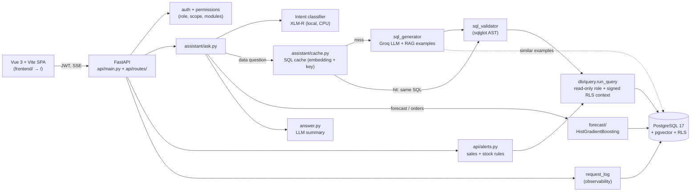

# Architecture

This document explains how a question becomes an answer, which decisions shaped the design (and why), and what the system knowingly does **not** do yet.

## 1. Overview

| Layer | Code | Responsibility |
|---|---|---|
| UI | `frontend/` (Vue 3 + Vite + Pinia + Vue Router), served at `/` | One view per page (home, login, shell, chat, profile, settings, users, admin, review). Built assets in `frontend/dist`; `/app/*` redirects to `/*` for old links |
| API | `api/main.py`, `api/routes/*.py`, `api/deps.py`, `api/schemas.py`, `api/errors.py` | App setup and security headers in `main.py`; one `APIRouter` per area; shared dependencies (rate limiters, module checks) and Pydantic bodies; errors as `{"detail": {"code", "message"}}` translated from `Accept-Language` |
| Identity | `api/auth.py`, `api/permissions.py` | bcrypt + JWT; the profile is re-read from the DB on every request |
| Orchestration | `assistant/ask.py` | Intent → refusal / chat / ML / SQL cache / text-to-SQL, one retry with the DB error; optional `on_event` callback for streaming |
| Extras | `assistant/cache.py`, `assistant/question_key.py`, `assistant/suggest.py`, `api/alerts.py` | SQL cache for repeated questions, follow-up suggestions (rules, no LLM), week-over-week sales and low-stock alerts |
| Schema | `db/schema.sql`, `db/migrations/`, `db/migrate.py` | Tables, then versioned (`V###`) and repeatable (`R__`) migrations with checksums |
| Data access | `db/query.py`, `db/pool.py` | Pooled connections; LLM SQL runs as a read-only role under row-level security |
| Observability | `observability.py`, `api/request_log.py`, `api/admin.py` | Per-request trace (latency, intent, SQL attempts, tokens) and the admin dashboard |
| Settings | `api/settings.py`, `frontend/src/lib/accent.ts` | Per-account theme/accent/language (in the DB) and admin-only app defaults, cached 30 s |
| Evaluation | `evaluate.py`, `eval_results.py`, `.github/workflows/eval.yml` | Execution accuracy on 40 questions, stored with a date on every run |

## 2. Life of a question

1. **Auth.** The JWT only proves *who* the user is. `current_user` loads role, brand/store scope and modules from the `users` table, so disabling an account or removing a module takes effect on the next request, not when the 8-hour token expires.
   Streaming uses the same path: `/ask/stream` runs it in a thread and forwards the `on_event` callbacks (`status`, `data`, `token`) as Server-Sent Events, then a `done` event with the same body as `/ask`.
2. **Intent.** XLM-RoBERTa classifies the question locally (~60 ms on CPU) into `data`, `forecast`, `orders`, `chat`, `personal_data`, `write` or `off_topic`. If confidence is below 0.90, or the question is a follow-up inside a conversation (e.g. *"and in Porto?"*), the LLM decides instead, because it can see the history.
3. **Module check.** Each path requires a module (`sql`, `forecast`, `orders`). Without it the answer is `kind="denied"`: no tokens are spent and the DB is not touched.
4. **SQL cache.** Outside a conversation, if the same profile asked for the same data today (an embedding-close question **with the same normalised key**), its SQL is reused and the LLM call of step 5 is skipped. The SQL still goes through validation and runs again under the asker's RLS.
5. **Text-to-SQL.** The prompt contains the schema *as the read-only role sees it* (private tables and personal columns are invisible to the LLM), business notes, up to 3 similar validated examples from pgvector, and the last 3 turns.
6. **Validation.** `sqlglot` parses the SQL and rejects anything that isn't a single `SELECT`: DML/DDL, `SELECT INTO`, locks, system catalogs, private tables, and dangerous functions (`set_config`, `dblink`, `pg_read_file`, `lo_*`…).
7. **Execution.** `run_query` borrows a connection from the read-only pool and sets `app.role`, `app.brand_id`, `app.store_id` and an HMAC signature, all transaction-local. RLS policies only trust the role if the signature matches a key stored in a table the LLM role cannot read. On a DB error the generator gets one retry with the error message.
8. **Answer.** A second LLM call writes 1–3 sentences from the rows (streamed token by token on `/ask/stream`); the UI renders a table, a chart, a "Source" panel with the SQL (and an **Explain** button that asks the LLM for a plain-language reading of it) and up to three follow-up suggestions.
9. **Logging.** The request is written to `request_log`: latency, intent and confidence, kind, SQL attempts, whether any attempt failed, cache hit, LLM calls and tokens. The user can rate the answer 👍/👎.

## 3. Key decisions

### Groq-hosted LLM instead of a fine-tuned local model

I fine-tuned Qwen2.5-Coder with LoRA on Kaggle and measured execution accuracy on the same 40 questions (`eval/`):

| Model | Accuracy |
|---|---|
| Qwen2.5-Coder-1.5B, base | 25 % |
| Qwen2.5-Coder-1.5B + LoRA | 45 % |
| Qwen2.5-Coder-7B + LoRA | 67.5 % |
| **gpt-oss-120b on Groq** | **97.5 % (hard questions: 30/30 over 3 runs)** |

Fine-tuning helped a lot (+20 points at 1.5B), but the hosted model is about 30 points better on multi-join, window-function and margin questions. It also needs no GPU to serve, and Groq's latency (~1–2 s per call) keeps the chat interactive. The cost is a dependency on an external API and its rate limits. Because the client uses the OpenAI-compatible API, switching providers or self-hosting is a configuration change (`LLM_BASE_URL`, `LLM_MODEL`).

### A local intent classifier before the LLM

Refusals (personal data, write requests, off-topic) shouldn't depend on the LLM following instructions, and shouldn't cost tokens. I compared two classifiers on 733 sentences with grouped 5-fold CV (split by template, so paraphrases of the same sentence never leak between train and test):

| Classifier | Accuracy | Decided without LLM |
|---|---|---|
| MiniLM embeddings + logistic regression | 94.8 % | 87.4 % at 0.70 threshold |
| **XLM-RoBERTa base, fine-tuned** | **97.8 %** | **98.1 % at 0.90 threshold (98.7 % accurate)** |

XLM-R is multilingual (PT/EN/ES/FR) and runs in ~60 ms on CPU. MiniLM remains as a lighter fallback (`INTENT_MODEL=minilm`).

### Row-level security with a signed context, not just a read-only role

A read-only role stops writes, but not a store manager reading every store. Filtering in Python would mean trusting the LLM's `WHERE` clause. So isolation lives in PostgreSQL:

- Policies on sales, stock, staff, transfers and purchases filter by store. Products, menus, recipes and margin views filter by brand.
- The policies call `visible_store_ids()` / `visible_brand_ids()`, wrapped as `(SELECT f())` so Postgres evaluates them once per query (InitPlan) rather than per row.
- The context is set with `set_config(..., true)`, which is transaction-local, so a pooled connection never carries the previous user's scope.
- **The HMAC is the important part.** Without it, a prompt-injected query could call `set_config('app.role', 'imperador', true)` and see the whole group. With it, a forged role has no valid signature, so `ctx_role()` returns NULL and every policy returns zero rows. The key lives in `app_secret`, which the `assistente` role cannot read, and `set_config` is also blocked by the validator.

This is defence in depth: validator → read-only role → RLS → signature. Any single layer failing does not leak data.

### Roles, scope and modules

The roles are `admin > imperador (group) > marca (brand) > loja (store)`. RLS only knows the last three, so the admin queries data as `imperador`. On top of the role, each account has **modules**: `sql`, `forecast`, `orders`, `teach`, `users` and `observability`. Rules (pure functions in `api/permissions.py`, unit-tested):

- You create accounts at your level or below, inside your scope (a brand manager only for their brand).
- You only grant modules you have yourself, capped by what the target role may have. `teach` changes RAG examples that every account uses, so it stays with admin/imperador. `observability` is admin-only.
- You manage lower levels in your scope, and same-level accounts only if you created them.
- The three public demo accounts are `protected`: only the admin can change them, so the public demo can't be vandalised.
- The admin account is never a demo account. It's created by `data/create_admin.py` from the private `.env`.

DB `CHECK` constraints repeat the essentials (role/scope consistency, username format), so a bug in Python can't store an inconsistent account.

### RAG over validated examples

Questions are embedded with multilingual MiniLM and stored in `sql_examples` (pgvector, cosine distance, threshold 0.6). Only examples that passed validation **and** `EXPLAIN` (it must run on this schema) are stored, and only accounts with `teach` can add them. Answers that failed are stored as `kind='error'` with no SQL, so broken SQL never feeds back as conversation memory or as an example.

### SQL cache: embeddings find, a question key decides

Many questions repeat in other words or another language. Before generating SQL, `assistant/cache.py` takes the 20 nearest questions in `query_cache` (MiniLM, distance ≤ 0.35) asked **today** with the **same data profile** (`imperador` / `marca` / `loja`), and reuses the SQL of the first one whose **normalised key** is identical.

**Why not just a distance threshold.** Measured on [`eval/cache_pairs.json`](../eval/cache_pairs.json): rewordings with the same meaning sit at 0.003–0.31, and different questions start at 0.016. *"5 stores with **most** revenue"* vs *"**least** revenue"* is 0.067; *"October 2026"* vs *"November 2026"* is 0.019. No threshold separates them: a strict one never hits (the first version, ≤ 0.08, matched 0 of 15 tuning rewordings) and a loose one returns the wrong SQL, which shows wrong numbers with full confidence. That is much worse than a miss, which only costs one LLM call.

**The key** (`assistant/question_key.py`) maps each word to a concept shared by the four languages (*faturação* = *revenue* = *facturación* = *vendas*; *outubro* = *october* = `m10`), binds groupings to the next dimension (*cada marca* = *por marca* = *each brand* = `by:brand`; *por faturação* after *top 5* is just ordering), keeps ranking direction (`top` / `bottom`) and comparisons (*mais de 10* = `gt`), drops filler words, and **keeps every unknown word as is**. Store names, filters (*sem*, *except*, *fim de semana*) and new terms must therefore appear in both questions. The word lists are deliberately conservative: an ambiguous word (*sold*, *vendu*) stays unknown, which only loses a hit.

Results: the *tuning* half of the pair set was used to write the word lists; the *holdout* half was written afterwards, without changing the code. On the holdout the key matches **19/20 rewordings** (the miss: *"How many sales were there yesterday?"*) and **0/20 different questions**. A unit test fails if any "different" pair ever shares a key.

Three more choices keep it safe:

- **SQL, not rows.** The cached SQL runs again with the asker's signed RLS context, so a hit from another store manager still returns only your store.
- **Same day.** The LLM gets today's date and may write literal dates for *"yesterday"* or *"this month"*, so entries expire at midnight.
- **Unknown words block, they never match loosely.** Adding a synonym is a one-line change, but only after checking it against the "different" pairs.

`query_cache` is owner-only (the read-only role cannot read it). Conversations with history skip the cache, because *"and in Porto?"* depends on the previous turn.

### Streaming with a thread and a queue

The pipeline is synchronous (psycopg, the OpenAI client, the local classifier). Rather than rewriting it with async code, `/ask/stream` runs the same `handle_ask` used by `/ask` in a worker thread and passes `queue.put` as the `on_event` callback; the response generator just drains the queue as SSE. The conversation, request log and RLS are identical on both routes. Access errors (wrong conversation, rate limit) are raised before streaming starts, so they still come back as normal JSON errors.

### Alerts as rules, not as a model

`api/alerts.py` compares each visible store's last 7 days with the 7 before (−8 % warns, −15 % is high, +10 % is shown as good news) and divides current stock by the forecast daily consumption from the order model. Thresholds are tuned to the synthetic data (week-over-week variation is about ±10 %, and stock is replenished daily, so the median cover is about one day); a real deployment would raise them. Results are cached for 10 minutes per scope and the text is rendered in the request language.

### Migrations

`db/schema.sql` creates the tables once. Everything after that (roles, RLS, views, indexes, the RAG and cache tables, admin columns) lives in `db/migrations/`: `V###__name.sql` run once in order, `R__name.sql` run again whenever their checksum changes (views and grants), all recorded in `schema_migrations` under an advisory lock. Files marked `-- migrate: no-transaction` (e.g. `REINDEX`) run statement by statement in autocommit. Docker runs `db.migrate` on every start.

### 👎 review: crowd feedback, one approver

A 👎 says an answer was wrong but not what right looks like, and letting every user write RAG examples would let one bad example degrade answers for everyone. So 👎 go to a review queue (`api/review.py`, `/review`) that only accounts with `teach` can see; `permissions.ROLE_MODULES` only allows that module for admin and Imperador. The reviewer fixes the SQL and must **test it first** (the UI only enables "Fix and teach" for the exact SQL that was just run, under the reviewer's RLS). Teaching then uses the same `teachable_sql` check as `/feedback` (validator + `EXPLAIN`). Two details matter for example quality: follow-ups (*"and in Porto?"*, detected as an earlier request in the same conversation) are flagged so the question gets rewritten to stand alone, and forecast answers can only be dismissed, because there is no SQL to fix. `request_log` keeps who decided what and when (`reviewed_at`, `reviewed_by`, `review_action`), with a check constraint so the three are set together, and a partial index serves the queue.

### Real weather and holidays, read from CSVs

The sales are synthetic, but they now react to the **real** daily weather of each store's district (Open-Meteo) and to Portuguese national and municipal holidays. The fetch scripts (`fetch_weather`, `fetch_holidays`) run by hand and write `data/weather.csv` and `data/holidays.csv`; the generator, the forecast and the alerts only read those files. That keeps the data reproducible, lets CI and Docker run offline, and means a provider outage can't change history. `signals.py` maps them to per-segment multipliers (ice cream follows temperature and rain, cafés go up in cold/rain and down on holidays, burgers up on holidays) and the model gets `temp_max`, `rain_mm` and `is_holiday` as features: MAE 109.90 € → 102.28 € on the same 60-day test set. Days beyond the CSV fall back to the district's monthly average, so a stale file degrades precision rather than breaking anything.

The alerts use the same files: thresholds are per segment (ice cream varies −24 %/+34 % week to week, cafés and burgers about ±11 %), and a drop is explained when the average high moved 2 °C or more, or rainy days changed by two or more.

### Demo accounts are read-only

The three demo accounts have their passwords in the README, so anything they can write, any visitor can write. Probing the API as `pedro` showed the admin account was already safe (higher level, invisible), but a visitor could **reset the password of a real store account** created by the admin, disable it, or create new Imperador accounts with the `users` module, each able to create more. `permissions.is_demo` (protected and not admin) now makes them read-only in account management and blocks changing their own password or photo; the check runs before any database access, the Accounts page stays visible (it's part of the showcase) and `/me` returns `demo: true` so the UI hides the buttons and explains why.

Teaching a 👎 writes the example and marks the 👎 as reviewed **in one transaction**; marking checks `rowcount`, so if someone else reviewed it in the meantime nothing is saved.

### RAG examples: visible, measured, editable

Examples serve every account, so they are managed like shared code: the **Examples** tab lists each one with its origin (`seed`, `feedback`, `review`, `manual`, enforced by a check constraint), author, last editor and a **use counter** that `find_similar` bumps every time the example goes into a prompt (owner pool, failure-safe). Editing re-embeds the question, because the question is what retrieval compares. Creating with a question that already exists returns 409 instead of silently overwriting (the chat and review paths do overwrite on purpose: that is how a fix replaces a wrong example).

### Classifier shortcuts are double-checked

The XLM-R classifier learned the *shape* "Que … devo …?" as `orders` with 99.9 % confidence, so *"Que produtos devo promover ou retirar da carta?"* went to the ingredient-order model and got an answer about burger buns. Retraining needs Kaggle, so `trust_shortcut` adds a keyword check: the `orders` shortcut is only taken if the question has an order/buy/restock word in one of the four languages; otherwise the LLM decides (and can still answer `ORDERS`). It can only remove a shortcut, never add one, and a unit test checks that every `orders` phrase in the training set still passes. The misread phrases were also added to the dataset as `data`, for the next training run.

### Fast plans under RLS: timestamps compared with timestamps

With RLS on, Postgres only uses a column's statistics for `LEAKPROOF` operators. The LLM writes dates as `sold_at >= CAST('2026-01-01' AS DATE)`, and `timestamp >= date` is not leakproof, so the planner estimated 1 row instead of ~380 000 and picked nested loops that hit the 10 s timeout (eval questions 16 and 27: over 30 s under RLS, 0.3 s without it). Changing the policies did not help; the validator now casts the other side of comparisons with timestamp columns to `TIMESTAMP`, the same value Postgres already used, so results are unchanged and the plans are normal again (0.02–0.7 s for all three roles). Integration tests time these queries per role and check the planner estimate.

### Two LLM keys

`GROQ_API_KEY_FALLBACK` is optional. The LLM client keeps the OpenAI SDK interface; on a quota error (HTTP 429) it retries the same request, streaming included, with the next key, and sets the exhausted key aside for the wait the provider reports. Other errors are not retried with another key.

### Password reset by email

`POST /password/forgot` answers the same whether or not the account exists and sends the email in the background, so neither the body nor the timing tells which emails are registered. Tokens are 32 random bytes; only their SHA-256 is stored, they expire after 30 minutes, are single use, and a new request cancels older links. The link carries the token in the URL fragment (`#token=`), which the browser never sends to the server, so it stays out of access logs, proxies and the Referer. Demo accounts can't have an email (a database check) and get a clear refusal, since their passwords are public anyway.

### Connection pool

Each `/ask` touches the DB 5–8 times (user, RAG, RLS key, query, conversation, log). `psycopg_pool` keeps two pools (owner and read-only) instead of a TCP + SCRAM handshake per call. Read-only connections are configured with `read_only = True` at creation. Offline scripts (data generation, training, evaluation) still use plain `psycopg.connect`.

### Observability built in, not bolted on

A `Trace` lives in a `ContextVar` for the duration of a request. The LLM wrappers add their token usage and `ask()` records intent and SQL attempts, without passing a tracker through every function signature. Saving the log can never break the answer: on failure it logs a warning and returns `None`. The admin dashboard computes error rate, p50/p95 latency, tokens per request, satisfaction from 👍/👎, SQL failures recovered by the retry, top questions, recent errors and per-user usage, straight from SQL.

### Evaluation as a time series

`evaluate.py` saves every run to `eval/results/<timestamp>.json` (summary + per-question detail + git commit) and appends to `eval/history.csv`. The GitHub workflow `eval` runs it on demand against a freshly built stack. The dashboard plots the history, so a prompt change or a model swap shows up as a number, not a feeling.

## 4. Security summary

| Threat | Mitigation |
|---|---|
| Prompt injection → destructive SQL | AST validator (single SELECT, blocked functions/tables), read-only role, `default_transaction_read_only`, 10 s statement timeout |
| Seeing other stores/brands | RLS on every scoped table, signed context, scope checks on account management |
| Personal data (GDPR) | Column-level grants: the LLM role never sees NIF/NISS/address. The classifier refuses before the LLM |
| Credential stuffing / brute force | bcrypt, constant-time login (dummy hash), per-IP and per-user rate limits |
| Stolen or stale tokens | 8 h expiry; profile re-read on every request, so a disabled account loses access at once |
| XSS / clickjacking | Vue text interpolation only (no `v-html`), CSP, `X-Frame-Options: DENY`, pinned CDN scripts with SRI |
| CSV injection | Cells starting with `= + - @` are prefixed when exporting |
| Account takeover via password reset | Hashed, single-use, 30-minute tokens in the URL fragment; same answer for unknown emails; rate limits per IP and per email; no reset for demo accounts |

## 5. Known limits

- **Single process.** Rate limits and the schema cache live in memory. Running several API replicas would need Redis (or similar) for both.
- **JWT revocation** is per account (disable/delete), not per token: there is no "log out all devices" list, and a password reset does not end sessions already open.
- **Filters that transform a timestamp column** (`EXTRACT(YEAR FROM sold_at) = 2026`, `sold_at::date = …`) still get no statistics under RLS; the validator only rewrites plain comparisons. None of the 40 eval questions uses them.
- **The LLM is external.** Questions and the schema description go to Groq. For a real client this needs a DPA, or a self-hosted model (the Qwen + LoRA path is documented but 30 points behind).
- **Synthetic data.** Sales follow seasonal patterns from a fixed seed. The forecast MAE is measured on this data, not on a real restaurant.
- **`request_log` keeps questions** after a user deletes a conversation, which is useful for auditing but has to be stated in a privacy policy. There is no automatic retention job yet.
- **Evaluation set size.** 40 questions is enough to compare models and catch regressions, not to claim a general accuracy. Execution accuracy also accepts "right rows for the wrong reason".
- **Streaming hides latency, it doesn't remove it.** The SQL step still has to finish before any text appears; p95 (~15–20 s on Groq's busy moments) now shows as progress steps instead of a blank wait.
- **The question key is a word list, not understanding.** It is predictable and testable, but a paraphrase with words it doesn't know (*"How many sales were there…"*) is a miss, and a rare phrasing it maps wrongly would be a wrong hit; the pair set and the zero-clash test are the guard. A learned paraphrase model could raise the hit rate, at the cost of that predictability.
- **Weather and holidays need a manual refresh.** `fetch_weather` needs internet and isn't run by Docker; past the end of `weather.csv` the forecast uses monthly averages. Municipal holidays are per district (from the district capital), so e.g. Oeiras inherits Lisbon's 13 June instead of its own 7 June.
- **The alert cache is per process.** Like the rate limiter, several replicas would each keep their own (the SQL cache lives in the database and is shared; the 10-minute alert cache is not).
- **"My brand" / "my store" rely on a prompt note.** The LLM is told that RLS already limits the scope and not to filter by name or use placeholders; before that, *"faturação de cada loja da minha marca"* produced `WHERE b.name ILIKE :marca`. A wrong guess still can't leak data (RLS), but it can fail.
- **Follow-up suggestions are rules.** They are cheap and predictable, but they don't understand the answer; an LLM could suggest better ones at the cost of tokens.
